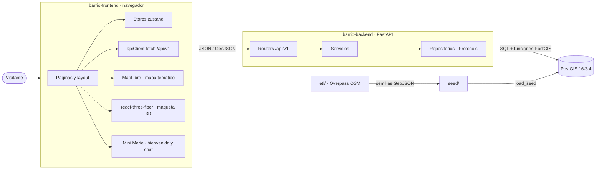
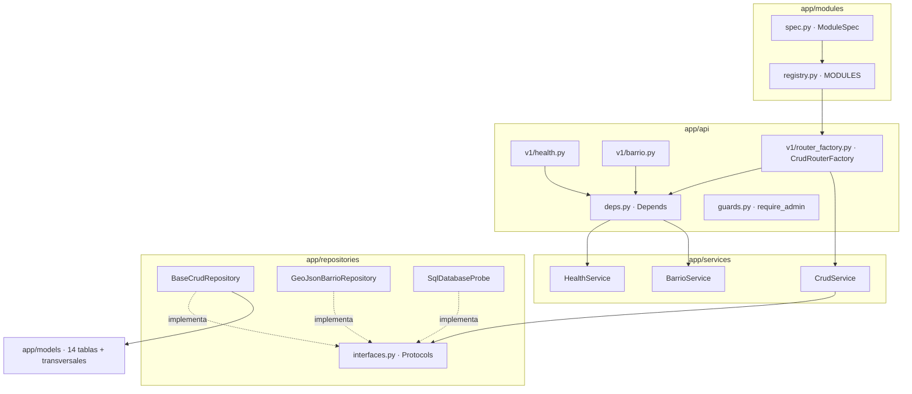
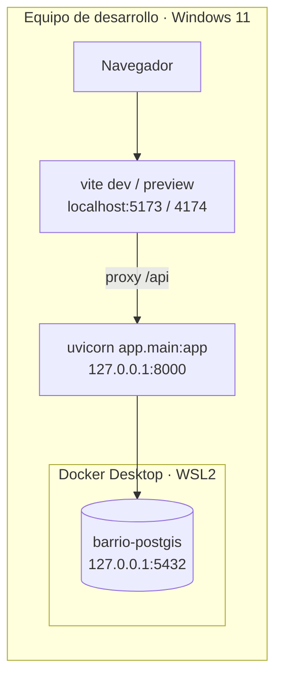

# Arquitectura — Reconoce tu Barrio: El Tintal

Estado al cierre de la Fase 3 (100 %). Publicado en https://reconoce-el-tintal.pages.dev (Cloudflare Pages + Render + Neon, D64). El detalle de cada componente está en `DISENO_FRONTEND.md`, `DISENO_API.md`, `DISENO_BACKEND.md` y `DISENO_BASE_DATOS.md`; las pruebas en `ESTRATEGIA_PRUEBAS.md`.

## 1. Vista general: tres capas

La aplicación separa presentación, lógica y datos en dos repositorios Git independientes:

| Capa | Repositorio | Tecnología | Responsabilidad |
|---|---|---|---|
| Frontend | `barrio-frontend/` | React 18.3.1, Vite 8, TypeScript 6 estricto, Tailwind 4, react-three-fiber 8, MapLibre 6, zustand 5, i18next | Interfaz, mapa temático, escena 3D, Mini Marie, accesibilidad e idioma |
| API + Backend | `barrio-backend/` | FastAPI 0.162, SQLAlchemy 2.1 (síncrono, D36), GeoAlchemy2 0.21, Alembic, Pydantic 2 | Contratos REST `/api/v1`, reglas de negocio, acceso a datos, ETL |
| Base de datos | contenedor `postgis/postgis:16-3.4` | PostgreSQL 16 + PostGIS 3.4, SRID 4326 | Persistencia geoespacial con índices GIST |

## 2. Componentes

### 2.1 Frontend (`barrio-frontend/src`)

| Carpeta | Contenido |
|---|---|
| `app/` | `AppShell` (header, sidebar, footer, barra de accesibilidad, chat, WhatsApp, bienvenida) y el árbol de rutas compartido por la app y las pruebas |
| `features/` | Páginas: inicio (hero 3D + carrusel), módulos (`ModulePage`: mapa + lista + detalle), FAQ, perfil de la creadora |
| `components/ui` | Botón, campo, tarjeta, tooltip, acordeón, modal, spinner, skeleton con sus 5 estados |
| `components/layout` | Header, Sidebar, Footer, AccessibilityRail, WhatsAppFloat, SkipLink |
| `components/avatar` | `AvatarSprite`, `WelcomeChoreography` (GSAP) |
| `components/chat` | `ChatWidget`, `ChatPanel`, `ChatBubble`, `ChatInput`, `useChatReactions` |
| `components/map`, `three/` | Mapa temático MapLibre y escena 3D de El Tintal |
| `store/` | `a11yStore`, `avatarStore`, `welcomeStore`, `chatStore`, `authStore` (sesión en memoria, D58), `loadingStore` (barra de carga, D61) |
| `lib/` | `categoryConfig.ts` (fuente única de los 14 módulos), `navigation.ts`, `apiClient.ts`, `avatarStateMachine.ts`, `chatLocalReplies.ts` |
| `i18n/` | `es.json` (por defecto) y `en.json` |

### 2.2 Backend (`barrio-backend/app`)

Capas `api → services → repositories → models`; cada capa solo conoce la de abajo por sus contratos:

- `app/main.py` es la fábrica de la aplicación: CORS con lista explícita, cabeceras de seguridad, manejadores de error con formato único `{"error": {"code", "message", "details"}}`.
- `app/modules/registry.py` lista los 14 módulos expuestos; se agregaron sin tocar el núcleo (fábricas genéricas, D41).
- `app/providers/` contiene el `ModelProvider` del chat (H22, D59): contrato en `model_provider.py`, `AnalyticModel`, `GenerativeModel` (+ `ClaudeTextGenerator`), `MoERouter` y la fábrica `factory.py`. Los modelos consultan el barrio por el protocolo `BarrioTools` (`providers/tools.py`), implementado sobre PostGIS en `repositories/barrio_tools.py`. `services/chat_agent.py` es el agente y `api/v1/chat.py` el endpoint `POST /api/v1/chat`.

### 2.3 Base de datos

- 14 tablas de módulo con `geom geometry(<TIPO>, 4326)` e índice GIST, más metadatos `source_type`, `source_ref`, `verified`, `created_at`, `updated_at` (mixins en `app/models/mixins.py`).
- Tablas transversales: `usuarios`, `calificaciones`, `fotos`, `historia_hitos`, `localidad_kennedy` (que también es el módulo 11, D40) (la tabla `faq_items` se retiró en D65: las preguntas frecuentes viven en las traducciones del frontend).
- Dos migraciones Alembic: la inicial (`9c91ab6b7857`) y una aditiva para los datos reales (`b51e0c7a2d4f`, D51), probadas contra una base propia (`tests/geo/test_migration.py`). Producción corre en Neon (PostgreSQL 18 + PostGIS 3.6.4); local, en Docker (PostgreSQL 16 + PostGIS 3.4).

## 3. Despliegue

- `barrio-backend/docker-compose.yml` levanta solo PostGIS, con volumen persistente, healthcheck y puerto publicado únicamente en `127.0.0.1`. La clave sale de `.env` (nunca del compose).
- El host de la base es `127.0.0.1`, no `localhost` (D37): en este Windows `localhost` resuelve primero a `::1` y la conexión esperaba hasta el timeout.
- Vite reenvía `/api` al backend en desarrollo y en vista previa (`vite.config.ts`), así que no hace falta CORS en local.

## 4. Flujo de datos

1. **Extracción (ETL).** `python -m etl.import_osm` consulta Overpass, recorta al polígono de El Tintal (D38) y escribe `seed/el_tintal_polygon.geojson` y `seed/base/*.geojson` (vías, parques, edificios, manzanas). `etl/import_modules.py` hace lo mismo para cada módulo (hoy: centros educativos, D42).
2. **Carga.** `python -m etl.load_seed` valida cada registro con el esquema de la API, exige `ST_Within` del polígono y conserva `source_type`, `source_ref` y `verified`.
3. **Consulta.** El frontend pide `GET /api/v1/centros-educativos` (lista paginada) y `/geojson` (FeatureCollection RFC 7946) para el mapa; `/api/v1/barrio/poligono` y `/api/v1/barrio/capas/{nombre}` (vías, parques, edificios, manzanas) alimentan el mapa y la maqueta 3D.
4. **Presentación.** Cada dato muestra su procedencia: «Verificado», «Por verificar» o «Dato de ejemplo».

## 5. Los cuatro conceptos del curso

| Concepto | Aplicación en el sistema | Estado |
|---|---|---|
| **Modelo** | `ModelProvider`: recibe la pregunta del usuario más el contexto de navegación y devuelve una respuesta con intención, entidades y acciones | ✅ H22 |
| **Tipos de modelo** | `AnalyticModel` (intención y ranking espacial sobre los datos de El Tintal), `GenerativeModel` (adaptador a un LLM con fallback determinista) y `MoERouter` (despacha por dominio entre expertos) | ✅ H22 |
| **Ambientes de ejecución** | **Local** por defecto (`AnalyticModel`, sin internet ni claves); **Nube** con `GenerativeModel` y una API key en `.env`; **Híbrido** con `MoERouter`. Se cambia por configuración, sin tocar lógica (ver 5.1) | ✅ H22 |
| **Agentes** | Mini Marie percibe la navegación (`useChatReactions`), decide una reacción (`avatarStateMachine`) y actúa en la interfaz (gestos, acciones rápidas que navegan) | Parte reactiva hecha en H12–H13; razonamiento con `ModelProvider` en H22–H23 |

El chat del frontend usa `POST /api/v1/chat` (H22–H23, D60); el repertorio local (`lib/chatLocalReplies.ts`) solo responde si el servidor no contesta.

### 5.1 Cómo cambiar de ambiente (sin tocar código)

En `barrio-backend/.env` (plantilla en `.env.example`) y reiniciando uvicorn:

| Ambiente | `.env` | Qué responde |
|---|---|---|
| **Local** (por defecto) | `CHAT_MODEL=analitico` | `AnalyticModel`: clasifica la intención con reglas, extrae el módulo y consulta PostGIS (conteos, ranking de calificaciones, cercanía con `ST_DWithin`, historia, localidad). Sin internet ni claves. |
| **Nube** | `CHAT_MODEL=generativo` + `ANTHROPIC_API_KEY=<clave>` (opcional `CHAT_LLM_MODEL`, por defecto `claude-opus-5-5`) | `GenerativeModel`: pide primero la respuesta analítica y Claude solo redacta el texto con esos datos; acciones y datos no cambian. Sin clave, o si Claude falla, se niega o tarda más de 12 s, responde el modelo analítico (`modelo: "generativo:respaldo"`). |
| **Híbrido** | `CHAT_MODEL=moe` (+ la clave para la parte de nube) | `MoERouter`: lo espacial y catastral al experto analítico, historia y localidad al experto documental (ambos locales) y la conversación abierta al experto generativo. La respuesta indica `experto`. |

La respuesta de `/api/v1/chat` dice qué modelo contestó (`modelo`, `experto`), para comprobar el ambiente activo.

## 6. Decisiones de arquitectura (ADR)

Las decisiones menores están en `PLAN_MAESTRO.md` (D1–D64). Aquí van las que serían caras de revertir.

### ADR-001: PostGIS como motor geoespacial
- **Estado:** Aceptada (2026-11-14).
- **Contexto:** la especificación permite PostGIS, MySQL o Spatialite. Se necesitan polígonos, líneas y puntos en SRID 4326, consultas de cercanía en metros, recorte por el polígono del barrio e índices espaciales.
- **Decisión:** PostgreSQL 16 + PostGIS 3.4 en Docker (`postgis/postgis:16-3.4`).
- **Alternativas:**
  - *MySQL 8:* tiene tipos espaciales, pero no hay distancias geodésicas en metros comparables a `geography` + `ST_DWithin`, ni un conjunto de funciones de geometría tan amplio (`ST_MakeValid`, `ST_Intersection` sobre multipolígonos). GeoAlchemy2 lo soporta peor. Descartada.
  - *Spatialite:* sin servidor y cómodo para un prototipo, pero es un archivo SQLite: no admite escritura concurrente de varios usuarios ni roles, y la API sería monousuario en la práctica. Descartada.
- **Consecuencias:** se depende de Docker Desktop + WSL2 (D1). A cambio, el recorte al polígono, las pruebas de geometría y `ST_Within` en la carga corren en el propio motor.

### ADR-002: dos repositorios y contrato HTTP
- **Estado:** Aceptada. **Contexto:** la especificación exige un repositorio para el Frontend y otro para API + Backend.
- **Decisión:** el único acoplamiento es el contrato `/api/v1` (JSON y GeoJSON) y los *slugs* de los módulos, que son iguales en `categoryConfig.ts` y en `app/modules/*.py`.
- **Consecuencia:** un cambio de contrato requiere un commit en cada repo; nunca se mezclan historiales (D21).

### ADR-003: CRUD por fábrica genérica
- **Estado:** Aceptada (D41). **Contexto:** 14 módulos con el mismo comportamiento y campos distintos.
- **Decisión:** `ModuleSpec` declara modelo, esquema y campos de búsqueda/filtro/orden; `CrudRouterFactory`, `CrudService` y `BaseCrudRepository` son genéricos.
- **Alternativa descartada:** 14 routers escritos a mano; habría más de 1 000 líneas casi iguales y cada corrección se repetiría 14 veces.
- **Consecuencia:** el módulo 15 es un archivo de spec y una línea en `registry.py`. Las rutas estáticas (`/geojson`, y en Fase 2 `/cercania`, `/ranking`, `/stats`) se registran antes de `/{item_id}` (D10).

### ADR-004: SQLAlchemy síncrono con psycopg 3
- **Estado:** Aceptada (D36). **Contexto:** el modo asíncrono de psycopg no admite el `ProactorEventLoop` de Windows.
- **Decisión:** sesiones síncronas; FastAPI ejecuta los endpoints `def` en su pool de hilos. Las pruebas usan `httpx.AsyncClient` + `ASGITransport`.
- **Consecuencia:** carga moderada sin problema; si en producción hiciera falta, se migraría a `asyncpg` en Linux.

### ADR-005: mapa sin teselas externas
- **Estado:** Aceptada (D5, D43). **Decisión:** MapLibre dibuja solo GeoJSON local de El Tintal (polígono, manzanas, vías, parques) en la paleta oficial, con `maxBounds` = bbox ± 0,04°.
- **Consecuencia:** ninguna petición a servidores de teselas y ningún color fuera de la paleta; a cambio, no hay mapa base de la ciudad alrededor del barrio.

### ADR-006: 3D con react-three-fiber 8 sobre React 18
- **Estado:** Aceptada (D44). **Contexto:** r3f 9/10 y drei 10 exigen React 19; el stack fija React 18.
- **Decisión:** `@react-three/fiber` 8.18.0, `@react-three/drei` 9.122.0 y `three` 0.172.0 fijos.
- **Consecuencia:** medido en H10: 40 352 triángulos (presupuesto 90 000) y 7,06 ms por cuadro con GPU real (D45). No se repitió en un equipo de gama media: la escena no cambió desde entonces (H27).

### ADR-007: territorio de El Tintal = UPZ 78 ∪ UPZ 79
- **Estado:** Aceptada por Marie como definición operativa (D38, D63): 662 ha según la SDP (2012); no es una unidad administrativa oficial; el Portal Américas queda fuera.
- **Contexto:** OSM no tiene un límite de «barrio El Tintal». Las UPZ 78 Tintal Norte y 79 Calandaima (Kennedy) contienen los lugares que llevan el nombre (Biblioteca El Tintal, Parque El Tintal, Tintal Plaza, Ciudad Tintal).
- **Decisión:** unión de las dos UPZ: 6,4966 km², centroide 4,653067 / −74,157404.
- **Consecuencia:** si Marie define otro límite, se cambia `etl/tintal_config.py` y se corre `python -m etl.import_osm`; el resto del sistema no cambia.

## 7. Seguridad (estado actual)

- Sesión JWT en cookie httpOnly (H21, D58): `require_admin` (401 sin sesión, 403 visitante) protege las escrituras; `require_user`, las calificaciones. Límite de intentos en login, registro y chat.
- CORS con orígenes explícitos y sin credenciales; cabeceras de seguridad en cada respuesta (`app/core/security_headers.py`).
- Errores con formato único y sin trazas internas (`app/core/exceptions.py`).
- Secretos solo en `.env` (ignorado por Git); `.env.example` con valores de ejemplo.
- `npm audit`: 0 vulnerabilidades en producción (D26).
