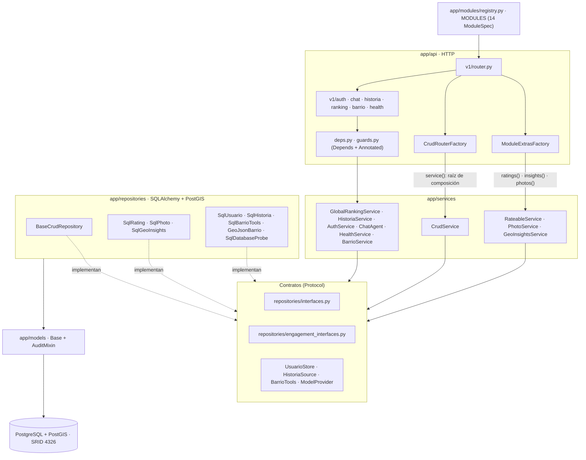
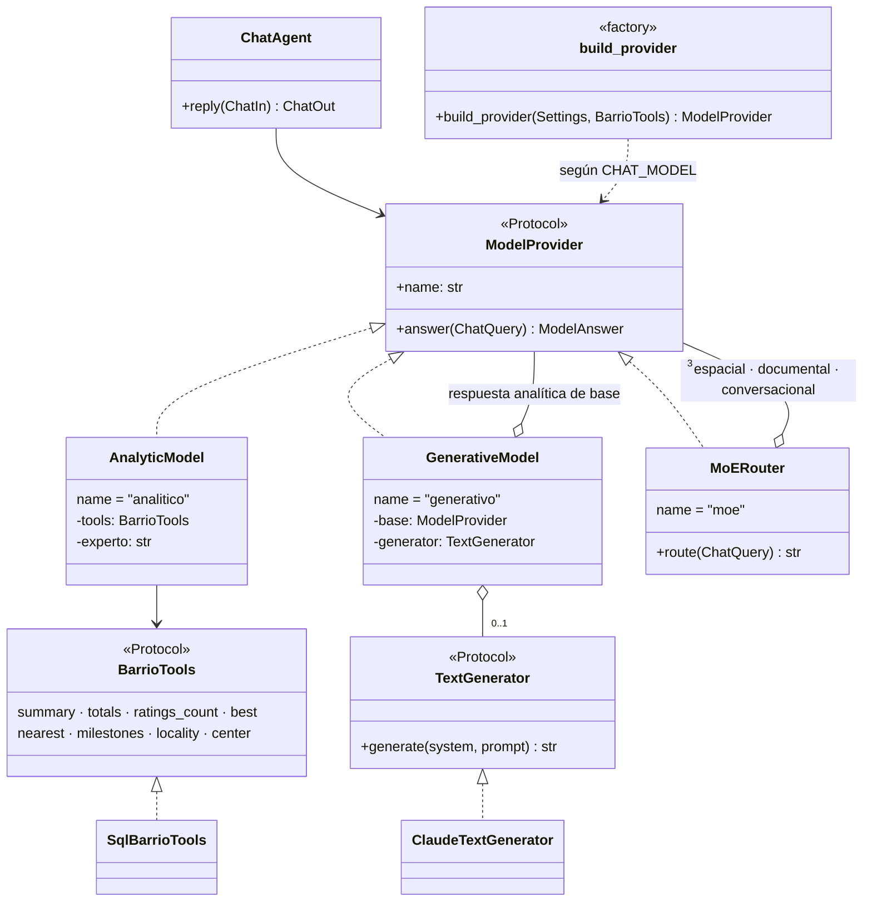

# Diseño del Backend — Reconoce tu Barrio: El Tintal

Diseño propio del componente Backend (`barrio-backend/`, repositorio Git 2), según `docs/origen/PROMPT_MAESTRO.md` (entregable 7 y §4.1). Cada afirmación cita el archivo que la respalda; las rutas son relativas a `barrio-backend/` salvo que digan otra cosa. Contexto general en `docs/ARQUITECTURA.md`; decisiones en `PLAN_MAESTRO.md` (Dnn).

| Pieza | Versión (`requirements.txt`) | Uso |
|---|---|---|
| FastAPI + Uvicorn | 0.162.7 / 0.54.0 | API HTTP `/api/v1` |
| SQLAlchemy 2 (síncrono) + psycopg 3 | 2.1.8 / 3.3.9 | ORM y driver (D36, `app/core/database.py`) |
| GeoAlchemy2 + PostGIS | 0.21.0 | Geometrías SRID 4326 con índice GIST |
| Alembic | 1.20.1 | Migraciones (`alembic/versions/`) |
| pydantic / pydantic-settings | 2.14.3 / 2.16.3 | Esquemas y configuración |
| httpx | 0.28.1 | Clientes del ETL |
| PyJWT + bcrypt | 2.15.1 / 5.0.0 | Sesión y contraseñas (D58) |
| anthropic | 2.3.0 | Solo ambiente Nube/Híbrido (D59) |

---

## 1. Capas y responsabilidades

Regla: cada capa conoce solo a la de abajo, y la conoce por un contrato (`Protocol`), no por su implementación.

| Capa | Carpeta | Responsabilidad | Depende de |
|---|---|---|---|
| **api** | `app/api/` | Traducir HTTP: rutas, parámetros, códigos de estado, cookie, guardas. Cablear dependencias con `Depends`. | services (y las raíces de composición eligen repositorios) |
| **modules** | `app/modules/` | Declarar cada uno de los 14 módulos como datos (`ModuleSpec`). | models, schemas |
| **services** | `app/services/` | Reglas de aplicación: 404 de dominio, limpiezas al borrar, ranking, login, agente de chat. | Protocolos de `repositories/` y `providers/` |
| **repositories** | `app/repositories/` | Hablar con PostgreSQL/PostGIS o con las semillas: consultas parametrizadas, `ST_AsGeoJSON`, `ST_DWithin`, transacciones. | models, SQLAlchemy |
| **models** | `app/models/` | Describir tablas: un archivo por tabla, `AuditMixin`, `geom_column`, CHECK. | `Base` (`app/models/base.py`) |
| **schemas** | `app/schemas/` | Contratos de entrada/salida (Pydantic). | — |
| **providers** | `app/providers/` | Modelos del chat (`ModelProvider`). | `BarrioTools`, `TextGenerator` |
| **core** | `app/core/` | Configuración, motor y sesión, errores, seguridad, cabeceras, límites. | — |



### 1.1 Ejemplo de punta a punta: `POST /api/v1/barberias`

1. **Registro.** `app/modules/barberias.py` declara `SPEC = ModuleSpec(slug="barberias", model=Barberia, create_schema=BarberiaCreate, ...)` y `app/modules/registry.py` lo incluye en `MODULES`. `app/api/v1/router.py` monta, para cada spec, `ModuleExtrasFactory(spec).build()` y luego `CrudRouterFactory(spec).build()` (D10: rutas estáticas antes de `/{item_id}`).
2. **Guarda.** La ruta `POST ""` lleva `dependencies=[Depends(require_admin)]` (`app/api/guards.py`): sin cookie `mm_session` válida responde 401; con sesión de visitante, 403.
3. **Validación.** FastAPI valida el cuerpo con `BarberiaCreate` (`app/schemas/modules/barberia.py`): hereda `AuditIn` (`extra="forbid"`, trazabilidad `source_type/source_ref/verified`) y usa los tipos de `app/schemas/modules/fields.py` (`Nombre`, `Direccion`, `PointGeometry`, …). Un error produce 422 con `details`.
4. **Composición.** `Depends(self.service)` ejecuta `CrudRouterFactory.service(session)`, que construye `BaseCrudRepository(session, Barberia, search_fields, filter_fields, sort_fields)` y un `CrudService` con las limpiezas `forget` de calificaciones y fotos.
5. **Servicio.** `CrudService.create` (`app/services/crud_service.py`) separa atributos y geometría y llama al repositorio por el protocolo `CrudRepository` (suma de `ReadableRepository`, `WritableRepository` y `SpatialQueryRepository`).
6. **Repositorio.** `BaseCrudRepository.create` (`app/repositories/base_geo_repo.py`) guarda la geometría con `ST_SetSRID(ST_GeomFromGeoJSON(...), 4326)`; `commit_or_conflict` (`app/repositories/transactions.py`) convierte un `IntegrityError` en 409. Relee el registro con `ST_AsGeoJSON(geom, 7)`.
7. **Modelo.** `Barberia` (`app/models/barberia.py`) = `AuditMixin` + columnas + `geom_column("POINT")` + CHECK de `calificacion_promedio` entre 0 y 5.
8. **Salida.** `CrudService._to_out` valida contra `out_schema` (generado por `output_schema`, `app/schemas/crud.py`) y el router responde 201.

---

## 2. Inyección de dependencias

- **Mecanismo.** `Annotated[Tipo, Depends(proveedor)]`. La sesión es `SessionDep` (`app/api/deps.py`): una por petición, cerrada siempre en `finally` (`app/core/database.py::get_session`). Los endpoints son `def` síncronos; FastAPI los corre en su pool de hilos (D36).
- **Singletons por proceso** con `@lru_cache`: `get_settings`, `get_engine`, `get_session_factory`, `get_barrio_repository` (una lectura de la semilla), `get_limiter`, `get_chat_limiter`, `get_chat_session_limiter`.
- **Dobles de prueba.** Al depender de protocolos, las pruebas sustituyen implementaciones sin tocar routers ni servicios (`tests/unit/chat_fakes.py`, `tests/api/crud_app.py`).

### 2.1 Contratos

| Protocolo | Archivo | Implementación real | Lo consume |
|---|---|---|---|
| `DatabaseProbe` | `app/repositories/interfaces.py` | `SqlDatabaseProbe` | `HealthService` |
| `BarrioRepository` | `app/repositories/interfaces.py` | `GeoJsonBarrioRepository` | `BarrioService`, `api/v1/chat.py` (centro del bbox) |
| `ReadableRepository`, `WritableRepository`, `SpatialQueryRepository` | `app/repositories/interfaces.py` | `BaseCrudRepository` | `CrudService` (vía `CrudRepository`) |
| `RatingRepository`, `PhotoRepository`, `Forgettable`, `GeoInsightsRepository` | `app/repositories/engagement_interfaces.py` | `SqlRatingRepository`, `SqlPhotoRepository`, `SqlGeoInsightsRepository` | `RateableService`, `PhotoService`, `GeoInsightsService`, `GlobalRankingService` |
| `UsuarioStore` | `app/services/auth_service.py` | `SqlUsuarioRepository` | `AuthService` |
| `HistoriaSource` | `app/services/historia_service.py` | `SqlHistoriaRepository` | `HistoriaService` |
| `BarrioTools` | `app/providers/tools.py` | `SqlBarrioTools` (`app/repositories/barrio_tools.py`) | `AnalyticModel` y manejadores |
| `TextGenerator` | `app/providers/generative_model.py` | `ClaudeTextGenerator` | `GenerativeModel` |
| `ModelProvider` | `app/providers/model_provider.py` | `AnalyticModel`, `GenerativeModel`, `MoERouter` | `ChatAgent`, `MoERouter` |

### 2.2 Raíces de composición

Son los únicos lugares donde se elige una implementación concreta; todo lo demás recibe abstracciones.

| Raíz | Archivo | Qué arma |
|---|---|---|
| `get_db_probe`, `get_health_service`, `get_barrio_repository`, `get_barrio_service` | `app/api/deps.py` | Salud y polígono |
| `get_auth_service`, `current_user` | `app/api/guards.py` | `AuthService(SqlUsuarioRepository)` |
| `CrudRouterFactory.service` | `app/api/v1/router_factory.py` | Repositorio y servicio CRUD de cada módulo |
| `ratings`, `insights`, `photos` (cierres en `build`) | `app/api/v1/module_extras.py` | Servicios de calificaciones, cercanía/estadísticas y galería |
| `get_ranking_service` | `app/api/v1/ranking.py` | `GlobalRankingService` con un etiquetador que reusa el CRUD de cada spec |
| `get_historia_service` | `app/api/v1/historia.py` | `HistoriaService(SqlHistoriaRepository)` |
| `get_chat_agent` + `build_provider` | `app/api/v1/chat.py`, `app/providers/factory.py` | `SqlBarrioTools` y el `ModelProvider` elegido por `CHAT_MODEL` |
| `create_app` | `app/main.py` | Middlewares, manejadores de error y router raíz |

---

## 3. Fábricas genéricas y Open/Closed

| Pieza | Archivo | Papel |
|---|---|---|
| `ModuleSpec` | `app/modules/spec.py` | Dataclass inmutable: `slug`, `model`, `create_schema`, `search_fields`, `filter_fields`, `sort_fields`, `within_tintal`. Deriva `update_schema` (`partial_schema`), `out_schema` (`output_schema`) y `label_field` (primer campo de `LABELS` presente). |
| `MODULES` | `app/modules/registry.py` | Tupla de los 14 `SPEC`, en el orden del frontend. |
| `CrudRouterFactory` | `app/api/v1/router_factory.py` | `GET ""` (paginado: `page`, `size` ≤ `MAX_PAGE_SIZE` = 100, `q`, `sort`, filtros), `GET /geojson` (hasta `MAX_FEATURES` = 5000), `GET /{item_id}`, `POST`, `PATCH`, `DELETE` (escrituras con `require_admin`). |
| `ModuleExtrasFactory` | `app/api/v1/module_extras.py` | `GET /cercania` (radio por defecto 500 m, máximo 5000), `GET /ranking`, `GET /stats`, `GET/POST /{id}/calificaciones` (POST con `require_user`), `GET/POST /{id}/fotos` y `DELETE /{id}/fotos/{foto_id}` (escrituras con `require_admin`). |
| `BaseCrudRepository` | `app/repositories/base_geo_repo.py` | CRUD genérico sobre cualquier modelo con `geom`; búsqueda `ILIKE` escapada, filtros tipados y orden solo sobre campos permitidos (`app/repositories/filters.py`). |
| `CrudService` | `app/services/crud_service.py` | Genérico en `T`; 404 de dominio, conversión a salida, `FeatureCollection` RFC 7946 y limpiezas `on_delete` (D53). |
| `AuditIn`, `partial_schema`, `output_schema` | `app/schemas/crud.py` | Un único esquema de creación por módulo genera el de PATCH y el de salida. |

### 3.1 Cómo se agrega el módulo 15

| Paso | Archivo nuevo o línea | ¿Toca el núcleo? |
|---|---|---|
| 1. Modelo con `AuditMixin`, `audit_checks` y `geom_column` | `app/models/<nombre>.py` + import en `app/models/__init__.py` (registra la tabla en `Base.metadata`) | No |
| 2. Migración aditiva | `alembic revision --autogenerate` → `alembic/versions/` | No |
| 3. Esquema de creación que herede `AuditIn` | `app/schemas/modules/<nombre>.py` | No |
| 4. Spec | `app/modules/<nombre>.py` con `SPEC = ModuleSpec(...)` | No |
| 5. Registro | una entrada en `MODULES` (`app/modules/registry.py`) | No |
| 6. Datos (opcional) | `seed/modules/<slug>.geojson`; si viene de OSM, un mapeo en `etl/modules/` (contrato `SLUG`, `SELECTORS`, `GEOMETRY`, `map_element`, `etl/modules/common.py`) y su entrada en `OSM_MODULES` (`etl/import_modules.py`) | No |

Con eso el módulo obtiene sus 14 rutas, calificaciones, galería, cercanía, estadísticas, presencia en `/ranking` global y en las herramientas del chat (`SPECS` de `barrio_tools.py`), carga en `etl/load_seed.py` y en `etl/bootstrap.py`: todos iteran `MODULES`. No cambian `CrudRouterFactory`, `ModuleExtrasFactory`, `CrudService`, `BaseCrudRepository` ni `router.py` (ADR-003, D41). En el frontend el módulo se declara en `src/lib/moduleFields.json` (D54).

---

## 4. Servicios transversales

| Servicio | Archivo | Depende de | Reglas principales | Endpoints |
|---|---|---|---|---|
| `RateableService` | `app/services/rating_service.py` | `RatingRepository`, `CrudService` | Solo se califica lo que existe (404 previo); estrellas 0–5 en pasos de 0,5 (`CalificacionIn`); guarda `usuario_id`; copia el promedio a `calificacion_promedio` si la tabla tiene esa columna (`sync_average`). | `/{slug}/{id}/calificaciones`, `/{slug}/ranking` |
| `PhotoService` | `app/services/photo_service.py` | `PhotoRepository`, `CrudService` | Solo rutas locales `/assets/photos/*.{jpg,jpeg,png,webp}` (`PHOTO_PATH`, `app/schemas/engagement.py`), con `alt_text`, autor, licencia y trazabilidad. | `/{slug}/{id}/fotos` |
| `GlobalRankingService` | `app/services/ranking_service.py` | `RatingRepository`, etiquetador | Mejor promedio, desempate por número de votos (`SqlRatingRepository.ranking`); omite lugares que ya no existen. | `/ranking` |
| `GeoInsightsService` | `app/services/geo_insights_service.py` | `GeoInsightsRepository`, `RatingRepository`, `CrudService` | Cercanía con `ST_DWithin` sobre `geography` (metros reales); estadísticas: total, verificados, por verificar, datos de ejemplo, calificados y promedio. | `/{slug}/cercania`, `/{slug}/stats` |
| `HistoriaService` | `app/services/historia_service.py` | `HistoriaSource` | Hitos ordenados por año; fuentes que respaldan hitos primero (D55–D57). | `/historia` |
| `AuthService` | `app/services/auth_service.py` | `UsuarioStore` | Mismo 401 para correo desconocido, clave errada o cuenta inactiva; registro siempre como `visitante`; 409 si el correo existe. | `/auth/*` |
| `ChatAgent` | `app/services/chat_agent.py` | `ModelProvider` | Ver §6. | `/chat` |
| `HealthService`, `BarrioService` | `app/services/` | `DatabaseProbe`, `BarrioRepository` | 503 si PostGIS no responde; polígono y capas base desde `seed/`. | `/health`, `/barrio/*` |

Al borrar un lugar, `CrudService.delete` ejecuta `forget` de calificaciones y fotos (polimórficas por `categoria_slug` + `objeto_id`), para que no queden huérfanas (D53).

---

## 5. ETL: OSM y Datos Abiertos de Bogotá

El ETL corre **solo en desarrollo** y produce archivos versionados en `seed/`; producción carga esas semillas sin red (`DEPLOY.md`).

### 5.1 Fuentes

| Fuente | Cliente | Script | Módulos o salida |
|---|---|---|---|
| Overpass API (OSM, ODbL 1.0) | `etl/overpass.py::OverpassClient` | `etl/import_osm.py` | Polígono El Tintal = UPZ 78 ∪ UPZ 79 (`etl/tintal_config.py`, D38/D63) y capas base `seed/base/{vias,parques,edificios,manzanas}.geojson` |
| Overpass API | ídem | `etl/import_modules.py` + `etl/modules/` | Educativos, deportivos, zonas verdes, calles, transporte, comida, librerías, veterinarias, barberías (D51) |
| Datos Abiertos de Bogotá (`etl/datos_abiertos/sources.py`) | `etl/datos_abiertos/client.py::OpenDataClient` | `etl/import_datos_abiertos.py` | Robos (Línea 123 NUSE), atención inmediata (CAI + IPS), datos catastrales (Lote + estrato), localidad (población + alcaldía, con la relación OSM de Kennedy) |
| Catálogo propio | — | `etl/load_historia.py` | `seed/historia.json` → `historia_hitos` |

Robustez del acceso a red:
- **Overpass:** 3 intentos con espera exponencial desde 5 s ante 429/5xx o error de transporte, timeout de 180 s, y validación de que la respuesta sea JSON con lista `elements`.
- **Datos abiertos:** lista blanca de hosts (`datosabiertos.bogota.gov.co`, `www.datos.gov.co`) solo por HTTPS (D4); caché en `etl/.cache/` con nombre por SHA-256 de la URL; escritura atómica `.part` → destino; lectura UTF-8 con respaldo Windows-1252. Los archivos de ciudad completa se filtran a El Tintal en PostGIS (`etl/datos_abiertos/geo.py`) y solo se persiste lo que cae dentro.

### 5.2 Orquestador y pasos (`etl/runner.py`)

```
python -m etl.runner                  # todos los pasos menos "base"
python -m etl.runner --con-base       # además rehace polígono y capas base
python -m etl.runner --solo osm,carga # pasos elegidos (un paso desconocido es error)
```

| Paso | Función | Transacción | Qué hace |
|---|---|---|---|
| `base` | `import_osm.run` | propia | Polígono y capas base |
| `osm` | `import_modules.run` | `_in_tx` | `seed/modules/<slug>.geojson` con `skipped` y motivo por elemento omitido |
| `datos-abiertos` | `import_datos_abiertos.run` | `_in_tx` | Semillas de robos, atención, catastro y localidad |
| `ejemplos` | `examples.run` | `_in_tx` | Completa hasta `MINIMO` = 3 registros en cámaras, veterinarias, librerías y barberías |
| `carga` | `load_seed.run` | por módulo | Semillas → PostGIS |
| `historia` | `load_historia.run` | propia | Hitos de la semilla |
| `admin` | `admin.run` | propia | Cuenta de administración |

Un paso nuevo es una entrada en `steps()` (OCP); así se sumaron `historia` y `admin`.

### 5.3 Trazabilidad

| Campo | Valores | Origen |
|---|---|---|
| `source_type` | `osm`, `datos_abiertos`, `seed` (CHECK en `app/models/mixins.py`, `Literal` en `AuditIn`) | Cada mapeo del ETL |
| `source_ref` | URL del elemento OSM (`trace`, `etl/modules/common.py`); página del conjunto + identificador (p. ej. `…#LOTCODIGO=…` en catastro); URLs separadas por ` \| ` (localidad, hitos); `"dato de ejemplo"` | ETL / `examples.py` |
| `verified` | `true` si la fuente lo respalda; `false` = «por verificar» (p. ej. zonas o escenarios OSM sin nombre, `etl/modules/areas.py`) | ETL |

- La UI muestra «Verificado», «Por verificar» (`verified=false`) o «Dato de ejemplo» (`source_ref="dato de ejemplo"`); `/stats` cuenta los tres (`SqlGeoInsightsRepository.counts`).
- Los ejemplos llevan «ejemplo» en el nombre o código, `source_type="seed"` y `verified=false`, en puntos reproducibles (semilla fija) dentro del polígono. **Atención inmediata nunca recibe ejemplos** (`etl/examples.py`).
- Cada hito de historia debe citar una URL del catálogo del mismo archivo; si uno no lo hace, se rechaza el archivo entero (`etl/load_historia.py::read`).

### 5.4 Idempotencia

| Paso | Mecanismo |
|---|---|
| Escritura de semillas | `etl/seed_writer.py`: features ordenadas por `osm_id` o `source_ref`, LF fijo: mismo dato, mismo archivo. |
| Descargas | Caché en disco: repetir el ETL no vuelve a descargar. |
| `carga` | `load_seed.load_module`: valida cada feature con el **mismo** `create_schema` de la API y exige `ST_Within` del polígono (salvo `within_tintal=False`, la ficha de Kennedy); borra las filas con los `source_ref` entrantes y las vuelve a crear. Lo rechazado se reporta con motivo. |
| `historia` | Borra los hitos `source_type="seed"` y los recarga: un hito retirado sale de la base (D56). |
| `admin` | Crea o actualiza (rol `admin`, activa, clave renovada). |
| `bootstrap` | Solo carga módulos vacíos (§8.2). |

### 5.5 Semillas offline

`seed/` (polígono, capas base, 14 módulos, `historia.json`) va en el repositorio. Con ella la API funciona sin Overpass ni el portal: el mapa usa `seed/base/` (sin teselas externas, D5) y producción ejecuta `etl/bootstrap.py`, que no usa red.

---

## 6. ModelProvider: el chat de Mini Marie

Patrones **Strategy + Factory** (PROMPT §4.1, D59). `ChatAgent` recibe un `ModelProvider` y no sabe cuál es.



| Pieza | Archivo | Comportamiento |
|---|---|---|
| `ChatQuery`, `ModelAnswer`, `ChatAction`, `Fact` | `app/providers/model_provider.py` | Contrato común; `ModelAnswer.by()` firma la misma respuesta con otro `modelo`/`experto`. |
| `AnalyticModel` | `app/providers/analytic_model.py` | Clasifica la intención con reglas (`intents.py`), extrae el módulo y despacha a `HANDLERS` (`analytic_handlers.py`, `documental_handlers.py`). Sin internet ni claves. |
| `GenerativeModel` | `app/providers/generative_model.py` | Pide primero la respuesta analítica y el LLM **solo redacta el texto** sobre el bloque DATOS; intención, acciones y datos no cambian. Mensaje del usuario delimitado (`<<<…>>>`) y declarado como texto, no instrucciones; respuesta recortada a 700 caracteres. Sin generador, con `GenerationError` o texto vacío → respuesta analítica firmada `generativo:respaldo`. |
| `ClaudeTextGenerator` | `app/providers/claude_generator.py` | SDK `anthropic`; timeout 12 s, `max_retries=0`, esfuerzo `low`, `fallbacks: "default"`; `stop_reason == "refusal"` → `GenerationError`. Se importa solo si hay clave (`factory.text_generator`). |
| `MoERouter` | `app/providers/moe_router.py` | Exige los tres expertos; enruta por `DOMAINS` (`intents.py`) y firma `moe:<modelo>` con el `experto`. |
| `ChatAgent` | `app/services/chat_agent.py` | Percibe mensaje, idioma, ruta y ubicación; quita acciones que llevan a la página actual; devuelve `ChatOut` (expresión del avatar, acciones, sugerencias, datos). |
| `SqlBarrioTools` | `app/repositories/barrio_tools.py` | Reusa los repositorios de módulos: conteos, ranking, cercanía (radio 1500 m, sin los módulos de `NOT_NEARBY`), hitos y ficha de la localidad. |

Enrutamiento del ambiente Híbrido (`DOMAINS`):

| Intenciones | Dominio | Experto |
|---|---|---|
| `categoria`, `robos`, `cercania`, `mejor_calificado`, `estadisticas` | espacial | `AnalyticModel(experto="espacial")` (local, PostGIS) |
| `historia`, `localidad` | documental | `AnalyticModel(experto="documental")` (local) |
| `saludo`, `ayuda`, `contacto`, `mapa`, `desconocido` | conversacional | `GenerativeModel` (nube, con respaldo local) |

### 6.1 Ambiente de ejecución: Local por defecto

El ambiente elegido es **Local** (`CHAT_MODEL=analitico`): es el valor por defecto en `app/core/config.py`, en `.env.example` y en `render.yaml`, y es el que corre en producción (`DEPLOY.md`). El camino Nube se probó solo con un cliente falso, no contra la API real (D62, `docs/INFORME_FASE_2_70pct.md`).

### 6.2 Procedimiento exacto para conmutar (sin tocar lógica)

Variables (todas en `Settings`, `app/core/config.py`):

| Variable | Valores | Por defecto | Efecto |
|---|---|---|---|
| `CHAT_MODEL` | `analitico` \| `generativo` \| `moe` (`Literal`: otro valor impide arrancar la API) | `analitico` | Elige la estrategia en `build_provider` |
| `ANTHROPIC_API_KEY` | clave de Anthropic (`SecretStr`, nunca se imprime) | vacía | Sin ella, `generativo` y `moe` responden con el analítico |
| `CHAT_LLM_MODEL` | id de modelo de Claude | `claude-opus-5-5` | Modelo que usa `ClaudeTextGenerator` |
| `CHAT_MESSAGES_PER_MINUTE` | entero | `30` | Límite por visitante, ventana de 60 s |
| `CHAT_MESSAGES_PER_HOUR` | entero | `120` | Límite por visitante, ventana de 3600 s (la «sesión», D62) |

Pasos en local:

1. En `barrio-backend/`, copia la plantilla si aún no existe: `cp .env.example .env`.
2. Edita **solo** el bloque del chat de `.env` según el ambiente:

   **Local** (por defecto; sin internet ni claves)
   ```dotenv
   CHAT_MODEL=analitico
   ANTHROPIC_API_KEY=
   ```

   **Nube** (cada mensaje pasa por Claude, que redacta sobre los datos analíticos)
   ```dotenv
   CHAT_MODEL=generativo
   ANTHROPIC_API_KEY=<tu clave>
   CHAT_LLM_MODEL=claude-opus-5-5
   CHAT_MESSAGES_PER_MINUTE=30
   CHAT_MESSAGES_PER_HOUR=120
   ```

   **Híbrido** (solo las intenciones conversacionales van a Claude; lo espacial y documental sigue local)
   ```dotenv
   CHAT_MODEL=moe
   ANTHROPIC_API_KEY=<tu clave>
   CHAT_LLM_MODEL=claude-opus-5-5
   ```
3. Reinicia uvicorn desde `barrio-backend/` (`uvicorn app.main:app --host 127.0.0.1 --port 8000`). Hace falta reiniciar porque `get_settings()` se cachea por proceso, y lanzarlo desde esa carpeta porque `.env` se lee relativo al directorio de trabajo (`env_file=".env"`). Una variable del entorno del proceso tiene prioridad sobre `.env` (pydantic-settings).
4. Comprueba el ambiente activo con el campo `modelo` (y `experto`) de la respuesta:
   ```
   curl -s -X POST http://127.0.0.1:8000/api/v1/chat -H "Content-Type: application/json" -d "{\"mensaje\":\"hola\"}"
   ```

| Ambiente | `modelo` esperado | `experto` |
|---|---|---|
| Local | `analitico` | `null` |
| Nube | `generativo`; `generativo:respaldo` si no hay clave, Claude falla, se niega, tarda más de 12 s o responde vacío | `null` |
| Híbrido | `moe:analitico` (espacial o documental); `moe:generativo` o `moe:generativo:respaldo` (conversacional) | `espacial` \| `documental` \| `conversacional` |

En producción (Render) el procedimiento es el mismo con las variables del servicio: `CHAT_MODEL` está fijado en `render.yaml` y `ANTHROPIC_API_KEY` no figura ahí. Para pasar a Nube o Híbrido se cambia `CHAT_MODEL` y se agrega `ANTHROPIC_API_KEY` como secreto en el panel; nunca en el repositorio.

**Qué no cambia en ningún caso:** `app/api/v1/chat.py`, `app/services/chat_agent.py`, los modelos de `app/providers/`, `app/repositories/barrio_tools.py` ni el frontend. El contrato `ChatOut` es idéntico en los tres ambientes (Liskov). La red hacia Anthropic solo ocurre si hay clave. Los límites por visitante existen porque en Nube cada mensaje puede ser una llamada pagada.

---

## 7. Seguridad

| Control | Implementación | Archivo |
|---|---|---|
| Contraseñas | bcrypt directo, 12 rondas; hash de relleno para igualar tiempos con correos desconocidos; clave de más de 72 bytes → `False` | `app/core/security.py` |
| Sesión | JWT HS256 con `sub`, `iat`, `exp` obligatorios (60 min por defecto); solo en la cookie `mm_session`: `HttpOnly`, `SameSite=Strict`, `Path=/api`, `Secure` en producción. El rol y `activo` se leen de la base en cada petición. | `app/core/security.py`, `app/api/v1/auth.py`, `app/api/guards.py` |
| Clave de firma | `JWT_SECRET` ≥ 32 caracteres; obligatoria en producción (`create_app` la exige al arrancar); fuera de producción, aleatoria por proceso | `app/core/security.py`, `app/main.py` |
| Autorización | `require_admin` (401 sin sesión, 403 visitante) en escrituras del CRUD y de fotos; `require_user` para calificar y `/auth/me` | `app/api/guards.py` |
| Límites de intentos | Ventana fija en memoria (`AttemptLimiter`), 429 con `retry_after_s`. Login: 10 fallos en 15 min por IP + correo (se reinicia al acertar). Registro: 10 intentos en 15 min por IP. Chat: 30/min y 120/h por IP | `app/core/rate_limit.py`, `app/api/v1/auth.py`, `app/api/v1/chat.py` |
| IP real tras el proxy | Se cree `X-Client-IP` solo si `X-Proxy-Secret` coincide con `PROXY_SECRET` (`secrets.compare_digest`) | `app/core/client_ip.py` |
| Errores | Formato único `{"error": {"code", "message", "details"}}`; excepción no controlada → 500 «Error interno del servidor», con la traza solo en el log; `IntegrityError` → 409 | `app/core/exceptions.py`, `app/repositories/transactions.py` |
| Entrada | Esquemas con `extra="forbid"`; filtros y orden solo sobre columnas permitidas; `LIKE` escapado; todo por expresiones parametrizadas | `app/schemas/`, `app/repositories/filters.py` |
| Cabeceras | `nosniff`, `X-Frame-Options: DENY`, `Referrer-Policy: no-referrer`, `Permissions-Policy`, `COOP same-origin`, CSP `default-src 'none'` fuera de `/docs` | `app/core/security_headers.py` |
| CORS | Orígenes explícitos, sin credenciales, métodos `GET POST PATCH DELETE`, cabecera `Content-Type` | `app/main.py` |
| Secretos | `SecretStr` para claves de base, JWT, admin, Anthropic y proxy; `.env` fuera de Git | `app/core/config.py` |
| Chat | Entrada ≤ 500 caracteres, salida ≤ 700; mensaje delimitado frente a inyección de instrucciones | `app/schemas/chat.py`, `app/providers/generative_model.py` |

---

## 8. Configuración y despliegue

### 8.1 `Settings` (`app/core/config.py`)

| Grupo | Variables | Notas |
|---|---|---|
| Entorno | `ENVIRONMENT` (`development` \| `test` \| `production`) | `production` apaga `/docs` y `/openapi.json`, exige `JWT_SECRET`, pone la cookie `Secure` y rechaza la clave de demostración del admin |
| Base | `POSTGRES_USER/PASSWORD/DB/HOST/PORT`, `DATABASE_URL` | Host `127.0.0.1` (D37). `DATABASE_URL` (p. ej. Neon con `sslmode=require`) reemplaza a las anteriores y se fuerza el driver `postgresql+psycopg` |
| API | `CORS_ORIGINS` (lista JSON) | |
| Sesión | `JWT_SECRET`, `JWT_EXPIRE_MINUTES` | |
| Admin | `ADMIN_EMAIL`, `ADMIN_PASSWORD` (≥ 12), `ADMIN_NOMBRE` | `etl/admin.py::check` |
| Chat | `CHAT_MODEL`, `ANTHROPIC_API_KEY`, `CHAT_LLM_MODEL`, `CHAT_MESSAGES_PER_MINUTE`, `CHAT_MESSAGES_PER_HOUR` | §6.2 |
| Proxy | `PROXY_SECRET` | §7 |
| Arranque | `RESEED_MODULES` (slugs separados por coma) | §8.2 |

Local: `docker compose up -d` (solo PostGIS 16-3.4, publicado en `127.0.0.1`, clave desde `.env`), `alembic upgrade head`, `python -m etl.runner --solo carga,historia,fotos,admin` (o el ETL completo con red) y uvicorn.

### 8.2 Arranque en producción (`etl/bootstrap.py`)

Comando de `render.yaml`: `python -m etl.bootstrap && uvicorn app.main:app --host 0.0.0.0 --port $PORT`.

1. `admin.check`: una clave de admin inválida detiene el arranque antes de tocar la base.
2. `CREATE EXTENSION IF NOT EXISTS postgis` y `alembic upgrade head`.
3. Semillas **por módulo vacío** (`load_missing`): un reinicio no cambia los id, así que calificaciones y fotos siguen valiendo, y un arranque cortado se completa en el siguiente.
4. `RESEED_MODULES=slug1,slug2` fuerza la recarga de esos módulos, para uso puntual: se quita después, porque recargar cambia sus id. Así se reparó Datos Catastrales en la publicación (D64).
5. Recarga la historia y crea o actualiza la cuenta de administración. Sin red.

### 8.3 Render + Neon (D62–D64)

- **API:** Render Web Service gratis, región virginia, Python 3.13.14, `healthCheckPath: /api/v1/health` (`render.yaml`).
- **Variables en el panel** (`sync: false`): `DATABASE_URL`, `CORS_ORIGINS`, `ADMIN_EMAIL`, `ADMIN_PASSWORD`, `PROXY_SECRET`. `JWT_SECRET` la genera Render (`generateValue`).
- **Base:** Neon (PostgreSQL + PostGIS).
- **Frontend:** llega por un proxy de Cloudflare Pages que reenvía `/api/*` con `PROXY_SECRET`. Guía completa en `docs/PUBLICACION.md` y `DEPLOY.md`.

---

## 9. Cumplimiento SOLID (resumen)

Detalle punto por punto en `docs/CHECKLIST_SOLID.md`.

| Principio | Evidencia | Archivos |
|---|---|---|
| **S** | Router = HTTP; servicio = reglas; repositorio = SQL/PostGIS; modelo = tabla. La autenticación está repartida en seis archivos y el chat en intención, léxico, frases, manejadores, agente y endpoint. | `app/api/`, `app/services/`, `app/repositories/`, `app/core/security.py`, `app/providers/` |
| **O** | 14 módulos = 14 `ModuleSpec` sin editar el núcleo; ambiente del chat por `CHAT_MODEL`; intención nueva = entrada en `HANDLERS`; paso de ETL nuevo = entrada en `steps()`. | `app/modules/registry.py`, `app/providers/factory.py`, `app/providers/analytic_model.py`, `etl/runner.py` |
| **L** | Los tres `ModelProvider` son intercambiables para `ChatAgent` y como expertos de `MoERouter`; `SqlBarrioTools` y su doble cumplen `BarrioTools`. | `app/providers/model_provider.py`, `tests/unit/test_generative_moe.py`, `tests/unit/chat_fakes.py` |
| **I** | Contratos pequeños: tres interfaces de lectura, escritura y espacial; tres de calificaciones, fotos y cercanía; `UsuarioStore` con 3 métodos; `TextGenerator` con 1. | `app/repositories/interfaces.py`, `app/repositories/engagement_interfaces.py` |
| **D** | Servicios y modelos dependen de protocolos, inyectados con `Depends`; `anthropic` solo se importa en `claude_generator.py` y solo si hay clave. | `app/api/deps.py`, `app/api/guards.py`, `app/providers/factory.py` |

### 9.1 Compromisos documentados

| Compromiso | Motivo | Mitigación |
|---|---|---|
| **35 `# type: ignore`** en `app/` y `etl/`: 17 `attr-defined` (atributos dinámicos de SQLAlchemy, como `id`/`geom` de modelos genéricos, `__table__` y `rowcount`) y 18 `valid-type` (tipos Pydantic creados en tiempo de ejecución: `geometry_schema`, los 14 esquemas de módulo y `Create`/`Update`/`PageOut[Out]` en `router_factory.py`) | Los genéricos sobre `type[Base]` y los modelos creados con `create_model` no son estáticos | Todos con código de error explícito; el proyecto no corre mypy (H29) |
| Idempotencia de semillas por `source_ref`, sin clave natural | Recargar borra y recrea, así que cambian los id; una fila cuyo `source_ref` cambió en la semilla no se borra | `etl/bootstrap.py` solo carga módulos vacíos y `RESEED_MODULES` es explícito (H29) |
| `BarrioTools` con 8 métodos | Es la caja de herramientas del agente | Cada manejador usa uno o dos; se dividirá por experto si crece (`CHECKLIST_SOLID.md`) |
| Límites de intentos en memoria | Vale para un solo proceso de uvicorn | Documentado en `app/core/rate_limit.py`; con varios procesos iría a un almacén común |
| SQLAlchemy síncrono | El modo asíncrono de psycopg no admite el `ProactorEventLoop` de Windows (D36, ADR-004) | Endpoints `def` en el pool de hilos de FastAPI |
| Raíces de composición dentro de las fábricas de routers | `CrudRouterFactory.service()` y `get_chat_agent` eligen la implementación | Son los únicos puntos y se inyectan con `Depends` (§2.2) |
