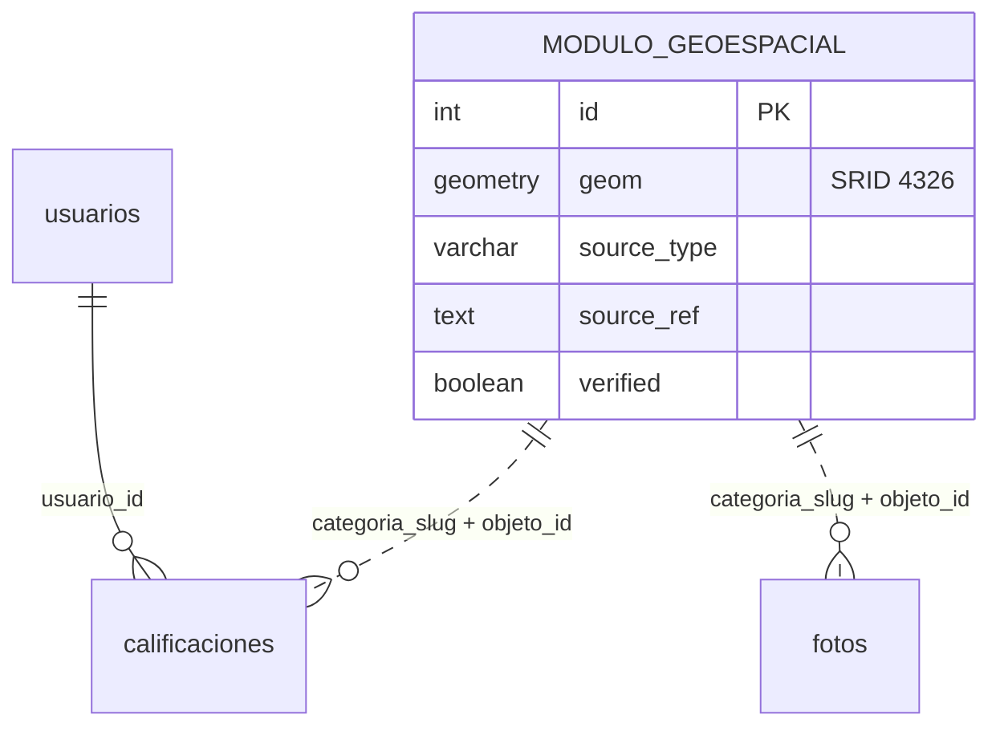

# Diseño de la Base de Datos — Reconoce tu Barrio: El Tintal

> **Actualización D65 (migración `c7d2e9a41f06`, aprobada por Marie):** `datos_catastrales.matricula_inmobiliaria` pasó a `codigo_lote` (con su UNIQUE), `ck_robos_ck_robos_cantidad` a `ck_robos_cantidad`, y se retiró `faq_items`. Las secciones de `faq_items` que siguen describen el esquema anterior y se conservan solo como historia.

> Entregable 8 del PROMPT_MAESTRO §6: modelo entidad-relación, diccionario de datos de las 14 tablas geoespaciales (SRID 4326) y de las tablas transversales, índices GIST y migraciones Alembic.
> Todo sale del código de `barrio-backend/` (`app/models/`, `alembic/`, `etl/`) y de la base local de desarrollo, consultada en modo solo lectura el 2026-11-14 (contenedor `barrio-postgis`, revisión Alembic `b51e0c7a2d4f`).

## 1. Motor y ambientes

| Ambiente | Motor | Dónde se define |
|---|---|---|
| Local (desarrollo y pruebas) | PostgreSQL 16.4 + PostGIS 3.4.3, imagen `postgis/postgis:16-3.4`, contenedor `barrio-postgis`, volumen `pgdata`, puerto solo en `127.0.0.1` | `barrio-backend/docker-compose.yml` |
| Producción | Neon `barrio-tintal`: PostgreSQL 18 + PostGIS 3.6.4 (us-east-1) | PLAN_MAESTRO D62–D64, `docs/PUBLICACION.md` |

- **Conexión:** SQLAlchemy 2 síncrono con psycopg 3 (`postgresql+psycopg`), `pool_pre_ping=True` y tiempo máximo de conexión configurable (`app/core/database.py`, ADR-004). En producción la cadena completa llega en `DATABASE_URL` (Neon, `sslmode=require`); en local se arma con las variables `POSTGRES_*` (`app/core/config.py`).
- **Una sesión por petición:** `get_session()` es una dependencia de FastAPI que cierra siempre la sesión.
- **Por qué PostGIS:** ADR-001 de `docs/ARQUITECTURA.md` (frente a MySQL 8 y Spatialite).
- **SRID 4326 (WGS 84, lon/lat):** es el sistema de OSM, del GeoJSON y de MapLibre, así que los datos se guardan y se sirven sin reproyectar. La constante `SRID = 4326` vive en `app/models/base.py` y la usan todas las columnas `geom`.
- **`geometry` para guardar, `geography` para medir:** las columnas son `geometry(<TIPO>, 4326)` (índice GIST y funciones como `ST_Within` o `ST_MakeValid`). En 4326 las unidades son grados, así que para distancias se convierte a `geography` en la consulta: `ST_DWithin(geom::geography, punto::geography, radio_m)` y `ST_Distance` dan **metros reales** sobre el elipsoide (`app/repositories/geo_insights_repository.py`, `nearby`). No hace falta guardar una segunda columna ni elegir una proyección local.
- **Extensiones** en la base local: `postgis`, `postgis_topology`, `postgis_tiger_geocoder` y `fuzzystrmatch` (vienen con la imagen). `alembic/env.py` (`include_object`) ignora las tablas que no son de los modelos (`spatial_ref_sys`, esquemas `tiger` y `topology`). En producción, `etl/bootstrap.py` ejecuta `CREATE EXTENSION IF NOT EXISTS postgis` antes de migrar.

## 2. Modelo entidad-relación

19 tablas del proyecto (más `alembic_version`, que es de Alembic):

- **14 tablas de módulo**, cada una con `geom` SRID 4326 (registradas en `app/modules/registry.py`). `localidad_kennedy` es a la vez el módulo 11 y la ficha transversal de Kennedy (D40).
- **4 tablas transversales:** `usuarios`, `calificaciones`, `fotos` e `historia_hitos`. `faq_items` existió hasta la migración `c7d2e9a41f06` (D65): nunca se usó, porque las preguntas frecuentes viven en las traducciones del frontend.

### 2.1 Diagrama completo

Línea continua = clave foránea real. Línea punteada = relación lógica sin FK (`categoria_slug` + `objeto_id`, ver 2.2).

```mermaid
erDiagram
    usuarios ||--o{ calificaciones : "usuario_id FK ON DELETE SET NULL"
    calificaciones }o..o| sitios_comida : "promedio copiado"
    calificaciones }o..o| librerias : "promedio copiado"
    calificaciones }o..o| veterinarias : "promedio copiado"
    calificaciones }o..o| barberias : "promedio copiado"

    usuarios {
        int id PK
        varchar email UK
        varchar nombre
        varchar password_hash "bcrypt"
        varchar rol "admin o visitante"
        boolean activo
        timestamptz created_at
    }
    calificaciones {
        int id PK
        varchar categoria_slug "slug del modulo"
        int objeto_id "id en la tabla del modulo"
        numeric estrellas "0 a 5, pasos de 0.5"
        text comentario
        varchar autor_nombre
        int usuario_id FK
        timestamptz created_at
    }
    fotos {
        int id PK
        varchar categoria_slug
        int objeto_id
        varchar url "/assets/photos/"
        varchar alt_text
        int orden
        varchar autor
        varchar licencia
    }
    historia_hitos {
        int id PK
        int anio
        varchar titulo
        text descripcion
        int orden
    }
    faq_items {
        int id PK
        text pregunta_es
        text respuesta_es
        text pregunta_en
        text respuesta_en
        int orden
    }
    localidad_kennedy {
        int id PK
        varchar nombre_localidad
        int poblacion
        float superficie_km2
        geometry_MULTIPOLYGON geom "nulo permitido"
    }
    centros_educativos {
        int id PK
        varchar nombre
        varchar tipo
        varchar caracter
        geometry_POINT geom
    }
    escenarios_deportivos {
        int id PK
        varchar nombre
        text deportes
        varchar acceso
        geometry_POLYGON geom
    }
    camaras_seguridad {
        int id PK
        varchar codigo UK
        varchar tipo
        varchar estado
        geometry_POINT geom
    }
    zonas_verdes {
        int id PK
        varchar nombre
        varchar tipo
        float area_m2
        geometry_POLYGON geom
    }
    datos_catastrales {
        int id PK
        varchar codigo_lote UK "codigo de lote"
        int estrato
        geometry_POLYGON geom
    }
    estado_calles {
        int id PK
        varchar nombre_via
        varchar estado "nulo = por verificar"
        geometry_LINESTRING geom
    }
    estaciones_transporte {
        int id PK
        varchar nombre
        varchar tipo
        geometry_POINT geom
    }
    sitios_comida {
        int id PK
        varchar nombre
        varchar rango_precios
        numeric calificacion_promedio
        geometry_POINT geom
    }
    librerias {
        int id PK
        varchar nombre
        numeric calificacion_promedio
        geometry_POINT geom
    }
    robos {
        int id PK
        date fecha
        varchar modalidad
        int cantidad
        geometry_POINT geom
    }
    atencion_inmediata {
        int id PK
        varchar nombre
        varchar tipo
        geometry_POINT geom
    }
    veterinarias {
        int id PK
        varchar nombre
        numeric calificacion_promedio
        geometry_POINT geom
    }
    barberias {
        int id PK
        varchar nombre
        numeric calificacion_promedio
        geometry_POINT geom
    }
```

El diagrama muestra solo las columnas que identifican cada entidad; el diccionario (§3) trae todas, incluidas las comunes de auditoría.

### 2.2 Relación polimórfica con los 14 módulos

`MODULO_GEOESPACIAL` no es una tabla: representa cualquiera de las 14. `calificaciones` y `fotos` apuntan a un registro con el par (`categoria_slug`, `objeto_id`), donde `categoria_slug` es el `slug` del `ModuleSpec` (`centros-educativos`, `escenarios-deportivos`, `camaras-seguridad`, `zonas-verdes`, `datos-catastrales`, `estado-calles`, `estaciones-transporte`, `sitios-comida`, `librerias`, `robos`, `localidad`, `atencion-inmediata`, `veterinarias`, `barberias`).

- **Por qué no hay FK:** una FK solo apunta a una tabla, y el patrón sirve para las 14 sin una tabla de calificaciones por módulo.
- **Cómo se protege la integridad:** antes de calificar se consulta el objeto por el CRUD del módulo y da 404 si no existe (`app/services/rating_service.py`). Borrar un lugar borra sus calificaciones y fotos (`CrudService.on_delete` y `SqlRatingRepository.forget`, D53). El índice compuesto (`categoria_slug`, `objeto_id`) hace rápidas estas búsquedas.
- **Promedio desnormalizado (D53):** `sitios_comida`, `librerias`, `veterinarias` y `barberias` tienen `calificacion_promedio`. Cada calificación nueva lo recalcula con `AVG(estrellas)` y lo copia redondeado a un decimal (`SqlRatingRepository.sync_average`). No se recibe al crear ni sale en el CRUD: el frontend lo lee de `/{id}/calificaciones` y `/ranking`.

## 3. Diccionario de datos

Convenciones: `varchar(n)` = `String(n)`. **Nulo** sale del tipo `Mapped[... | None]` del modelo. Los nombres de las restricciones siguen la convención de `app/models/base.py` (`pk_<tabla>`, `uq_<tabla>_<col>`, `ck_<tabla>_<nombre>`, `fk_<tabla>_<col>_<tabla_ref>`).

### 3.1 Columnas comunes (`AuditMixin`, `app/models/mixins.py`)

Las 14 tablas de módulo, `fotos` e `historia_hitos` heredan estas columnas, y todas tienen el CHECK de `source_type`. `usuarios`, `calificaciones` y `faq_items` **no** usan el mixin: tienen `id` y `created_at` propios.

| Columna | Tipo | Nulo | Restricción / defecto | Descripción |
|---|---|---|---|---|
| `id` | integer | no | PK, serial | Identificador. |
| `source_type` | varchar(20) | no | defecto `'seed'`; CHECK IN (`osm`, `datos_abiertos`, `seed`) | Origen del registro. |
| `source_ref` | text | sí | — | Referencia exacta: URL de OSM (`https://www.openstreetmap.org/way/…`), URL del conjunto de datos abiertos con su clave (`…/dataset/lote#LOTCODIGO=…`) o el texto `dato de ejemplo`. La carga es idempotente por este valor (§6). |
| `verified` | boolean | no | defecto `false` | `false` se muestra «por verificar»; con `source_ref = 'dato de ejemplo'` se rotula «dato de ejemplo». |
| `created_at` | timestamptz | no | defecto `now()` | Fecha de creación. |
| `updated_at` | timestamptz | no | defecto `now()`; `onupdate=now()` en el ORM | Última modificación. |

Columna geométrica (`geom_column`): `geom geometry(<TIPO>, 4326)`, no nula salvo en `localidad_kennedy`, con índice GIST `idx_<tabla>_geom`.

### 3.2 Las 14 tablas de módulo

Cada tabla lista solo sus columnas propias; todas tienen además las de 3.1.

**`centros_educativos`** — POINT (`app/models/centro_educativo.py`)

| Columna | Tipo | Nulo | Restricción | Descripción |
|---|---|---|---|---|
| `nombre` | varchar(200) | no | — | Nombre del centro. |
| `tipo` | varchar(20) | no | CHECK IN (`jardin`, `colegio`, `universidad`) | Nivel de la institución. |
| `caracter` | varchar(10) | no | CHECK IN (`publico`, `privado`) | Carácter. |
| `direccion` | varchar(200) | sí | — | Dirección. |
| `jornadas` | text | sí | — | Jornadas. |
| `niveles` | text | sí | — | Niveles ofrecidos. |
| `telefono` | varchar(30) | sí | — | Teléfono. |
| `geom` | geometry(POINT, 4326) | no | GIST | Ubicación. |

**`escenarios_deportivos`** — POLYGON (`app/models/escenario_deportivo.py`)

| Columna | Tipo | Nulo | Restricción | Descripción |
|---|---|---|---|---|
| `nombre` | varchar(200) | no | — | Nombre. |
| `deportes` | text | no | — | Deportes que se practican. |
| `superficie` | varchar(60) | sí | — | Tipo de superficie. |
| `iluminacion` | boolean | sí | — | Tiene iluminación. |
| `horario` | varchar(120) | sí | — | Horario. |
| `acceso` | varchar(20) | sí | CHECK IN (`libre`, `restringido`, `pago`) | Tipo de acceso. |
| `geom` | geometry(POLYGON, 4326) | no | GIST | Contorno. |

**`camaras_seguridad`** — POINT (`app/models/camara_seguridad.py`)

| Columna | Tipo | Nulo | Restricción | Descripción |
|---|---|---|---|---|
| `codigo` | varchar(40) | no | UNIQUE `uq_camaras_seguridad_codigo` | Código de la cámara. |
| `tipo` | varchar(20) | no | CHECK IN (`policial`, `comunitaria`, `privada`) | Tipo. |
| `operador` | varchar(120) | sí | — | Quién la opera. |
| `estado` | varchar(20) | sí | CHECK IN (`activa`, `inactiva`, `mantenimiento`) | Estado. |
| `fecha_instalacion` | date | sí | — | Fecha de instalación. |
| `geom` | geometry(POINT, 4326) | no | GIST | Ubicación. |

**`zonas_verdes`** — POLYGON (`app/models/zona_verde.py`)

| Columna | Tipo | Nulo | Restricción | Descripción |
|---|---|---|---|---|
| `nombre` | varchar(200) | no | — | Nombre. |
| `area_m2` | double precision | sí | — | Área en m². |
| `tipo` | varchar(20) | no | CHECK IN (`parque`, `alameda`, `jardin`) | Tipo. |
| `arborizacion` | varchar(20) | sí | CHECK IN (`alta`, `media`, `baja`) | Nivel de arborización. |
| `estado` | varchar(20) | sí | CHECK IN (`bueno`, `regular`, `malo`) | Estado. |
| `geom` | geometry(POLYGON, 4326) | no | GIST | Contorno. |

**`datos_catastrales`** — POLYGON (`app/models/dato_catastral.py`)

| Columna | Tipo | Nulo | Restricción | Descripción |
|---|---|---|---|---|
| `codigo_lote` | varchar(40) | no | UNIQUE `uq_datos_catastrales_codigo_lote` | Guarda el **código de lote catastral (LOTCODIGO)** de la UAECD, porque la matrícula no es pública (D51). |
| `direccion` | varchar(200) | sí | — | Dirección. |
| `area_lote_m2` | double precision | sí | — | Área del lote. |
| `area_construida_m2` | double precision | sí | — | Área construida (nula en los datos reales, D51). |
| `pisos` | integer | sí | — | Pisos (nulo, D51). |
| `uso` | varchar(40) | sí | — | Uso (nulo, D51). |
| `avaluo_cop` | numeric(16,0) | sí | — | Avalúo en pesos (nulo, D51). |
| `estrato` | integer | sí | CHECK `estrato BETWEEN 1 AND 6` | Estrato de la manzana (SDP). |
| `geom` | geometry(POLYGON, 4326) | no | GIST | Contorno del lote. |

**`estado_calles`** — LINESTRING (`app/models/estado_calle.py`)

| Columna | Tipo | Nulo | Restricción | Descripción |
|---|---|---|---|---|
| `nombre_via` | varchar(200) | no | — | Nombre de la vía. |
| `tipo_via` | varchar(40) | sí | — | Tipo de vía. |
| `material` | varchar(40) | sí | — | Material de la superficie. |
| `estado` | varchar(20) | sí | CHECK IN (`bueno`, `regular`, `malo`) | Nulo = «por verificar»: ninguna fuente abierta da la clase por tramo; «malo» solo para afirmado/tierra (D51). |
| `ultima_intervencion` | date | sí | — | Última intervención. |
| `reportes_ciudadanos` | integer | sí | — | Número de reportes. |
| `geom` | geometry(LINESTRING, 4326) | no | GIST | Eje del tramo. |

**`estaciones_transporte`** — POINT (`app/models/estacion_transporte.py`)

| Columna | Tipo | Nulo | Restricción | Descripción |
|---|---|---|---|---|
| `nombre` | varchar(200) | no | — | Nombre. |
| `tipo` | varchar(20) | no | CHECK IN (`troncal`, `alimentador`, `sitp`) | Tipo de estación o paradero. |
| `lineas` | text | sí | — | Rutas que pasan. |
| `direccion` | varchar(200) | sí | — | Dirección. |
| `geom` | geometry(POINT, 4326) | no | GIST | Ubicación. |

**`sitios_comida`** — POINT (`app/models/sitio_comida.py`)

| Columna | Tipo | Nulo | Restricción | Descripción |
|---|---|---|---|---|
| `nombre` | varchar(200) | no | — | Nombre. |
| `especialidad` | varchar(120) | sí | — | Tipo de comida. |
| `direccion` | varchar(200) | sí | — | Dirección. |
| `horario` | varchar(120) | sí | — | Horario. |
| `rango_precios` | varchar(5) | sí | CHECK IN (`$`, `$$`, `$$$`) | Rango de precios. |
| `calificacion_promedio` | numeric(2,1) | sí | CHECK `BETWEEN 0 AND 5` | Promedio copiado de `calificaciones` (D53). |
| `geom` | geometry(POINT, 4326) | no | GIST | Ubicación. |

**`librerias`** — POINT (`app/models/libreria.py`)

| Columna | Tipo | Nulo | Restricción | Descripción |
|---|---|---|---|---|
| `nombre` | varchar(200) | no | — | Nombre. |
| `direccion` | varchar(200) | sí | — | Dirección. |
| `horario` | varchar(120) | sí | — | Horario. |
| `especialidad` | varchar(120) | sí | — | Especialidad. |
| `calificacion_promedio` | numeric(2,1) | sí | CHECK `BETWEEN 0 AND 5` | Promedio copiado (D53). |
| `geom` | geometry(POINT, 4326) | no | GIST | Ubicación. |

**`robos`** — POINT (`app/models/robo.py`)

| Columna | Tipo | Nulo | Restricción | Descripción |
|---|---|---|---|---|
| `fecha` | date | no | — | Mes del agregado (Línea 123 NUSE, desde 2024-01). |
| `franja_horaria` | varchar(20) | sí | CHECK IN (`madrugada`, `manana`, `tarde`, `noche`) | Nula si la fuente no la trae (la 123 agrega por mes, D51). |
| `modalidad` | varchar(60) | no | — | Tipo de incidente. |
| `fuente` | varchar(200) | no | — | Entidad que publica el dato. |
| `cantidad` | integer | sí | CHECK `cantidad >= 0` | Hechos agregados que representa el registro (dato anonimizado). |
| `geom` | geometry(POINT, 4326) | no | GIST | `ST_PointOnSurface` de la UPZ, no la ubicación del hecho (D51). |

**`localidad_kennedy`** — MULTIPOLYGON, módulo 11 y tabla transversal (`app/models/localidad_kennedy.py`, D40)

| Columna | Tipo | Nulo | Restricción | Descripción |
|---|---|---|---|---|
| `nombre_localidad` | varchar(120) | no | — | Nombre (`Kennedy`). |
| `bandera_url` | varchar(300) | sí | — | Ruta local de la bandera (solo `/…`). |
| `historia` | text | sí | — | Reseña histórica. |
| `poblacion` | integer | sí | — | Población (SDS 2026). |
| `superficie_km2` | double precision | sí | — | Superficie. |
| `alcaldia_local` | varchar(200) | sí | — | Alcaldía local. |
| `retos` | text | sí | — | Retos de la localidad. |
| `geom` | geometry(MULTIPOLYGON, 4326) | **sí** | GIST | Límite de Kennedy (OSM 4740229). Única `geom` opcional; su módulo usa `within_tintal=False` porque abarca toda la localidad. |

**`atencion_inmediata`** — POINT (`app/models/atencion_inmediata.py`)

| Columna | Tipo | Nulo | Restricción | Descripción |
|---|---|---|---|---|
| `nombre` | varchar(200) | no | — | Nombre (CAI o unidad de salud). |
| `tipo` | varchar(20) | no | CHECK IN (`cai`, `hospital`, `urgencias`) | Tipo de servicio. |
| `direccion` | varchar(200) | sí | — | Dirección. |
| `telefono_24_7` | varchar(30) | sí | — | Teléfono permanente. |
| `geom` | geometry(POINT, 4326) | no | GIST | Ubicación. |

**`veterinarias`** — POINT (`app/models/veterinaria.py`)

| Columna | Tipo | Nulo | Restricción | Descripción |
|---|---|---|---|---|
| `nombre` | varchar(200) | no | — | Nombre. |
| `servicios` | text | sí | — | Servicios. |
| `direccion` | varchar(200) | sí | — | Dirección. |
| `horario` | varchar(120) | sí | — | Horario. |
| `calificacion_promedio` | numeric(2,1) | sí | CHECK `BETWEEN 0 AND 5` | Promedio copiado (D53). |
| `geom` | geometry(POINT, 4326) | no | GIST | Ubicación. |

**`barberias`** — POINT (`app/models/barberia.py`)

| Columna | Tipo | Nulo | Restricción | Descripción |
|---|---|---|---|---|
| `nombre` | varchar(200) | no | — | Nombre. |
| `direccion` | varchar(200) | sí | — | Dirección. |
| `horario` | varchar(120) | sí | — | Horario. |
| `servicios` | text | sí | — | Servicios. |
| `calificacion_promedio` | numeric(2,1) | sí | CHECK `BETWEEN 0 AND 5` | Promedio copiado (D53). |
| `geom` | geometry(POINT, 4326) | no | GIST | Ubicación. |

### 3.3 Tablas transversales

**`usuarios`** (`app/models/usuario.py`) — sin `AuditMixin`

| Columna | Tipo | Nulo | Restricción / defecto | Descripción |
|---|---|---|---|---|
| `id` | integer | no | PK | Identificador. |
| `email` | varchar(254) | no | UNIQUE `uq_usuarios_email` | Correo de acceso. |
| `nombre` | varchar(120) | no | — | Nombre visible. |
| `password_hash` | varchar(255) | no | — | Solo el hash bcrypt (12 rondas, `app/core/security.py`); nunca la clave en texto plano. |
| `rol` | varchar(20) | no | defecto `'visitante'`; CHECK IN (`admin`, `visitante`) | `admin` = CRUD completo; `visitante` = consulta y calificaciones. |
| `activo` | boolean | no | defecto `true` | Cuenta habilitada. |
| `created_at` | timestamptz | no | defecto `now()` | Alta. |

**`calificaciones`** (`app/models/calificacion.py`) — sin `AuditMixin`

| Columna | Tipo | Nulo | Restricción / defecto | Descripción |
|---|---|---|---|---|
| `id` | integer | no | PK | Identificador. |
| `categoria_slug` | varchar(40) | no | índice compuesto con `objeto_id` | Slug del módulo calificado. |
| `objeto_id` | integer | no | — | `id` del registro en la tabla del módulo (relación lógica, §2.2). |
| `estrellas` | numeric(2,1) | no | CHECK `estrellas BETWEEN 0 AND 5 AND estrellas * 2 = floor(estrellas * 2)` | De 0,0 a 5,0 en pasos de 0,5. |
| `comentario` | text | sí | — | Reseña opcional. |
| `autor_nombre` | varchar(120) | sí | — | Nombre que se muestra. |
| `usuario_id` | integer | sí | FK → `usuarios.id` `ON DELETE SET NULL` | Autor con sesión; si se borra la cuenta, la reseña queda anónima. |
| `created_at` | timestamptz | no | defecto `now()` | Fecha (ordena las últimas reseñas). |

**`fotos`** (`app/models/foto.py`) — con `AuditMixin`

| Columna | Tipo | Nulo | Restricción / defecto | Descripción |
|---|---|---|---|---|
| `categoria_slug` | varchar(40) | no | índice compuesto con `objeto_id` | Slug del módulo. |
| `objeto_id` | integer | no | — | Registro al que pertenece la foto. |
| `url` | varchar(500) | no | — | Ruta local bajo `/assets/photos/` del frontend (sin enlaces externos, D53). |
| `alt_text` | varchar(300) | no | — | Texto alternativo (accesibilidad). |
| `orden` | integer | no | defecto `0` | Orden en la galería. |
| `autor` | varchar(200) | sí | — | Autor de la imagen. |
| `licencia` | varchar(120) | sí | — | Licencia. |

**`historia_hitos`** (`app/models/historia_hito.py`) — con `AuditMixin`

| Columna | Tipo | Nulo | Restricción / defecto | Descripción |
|---|---|---|---|---|
| `anio` | integer | no | — | Año del hito. |
| `titulo` | varchar(200) | no | — | Título. |
| `descripcion` | text | no | — | Descripción. |
| `orden` | integer | no | defecto `0` | Orden en la línea de tiempo. |

`source_ref` guarda la URL o las URL de la fuente (separadas por ` | `), que deben estar en el catálogo de `seed/historia.json` (D55–D57). Sin fuente confirmada, `verified=false` («por verificar»).

**`faq_items`** (`app/models/faq_item.py`) — sin `AuditMixin`

| Columna | Tipo | Nulo | Restricción / defecto | Descripción |
|---|---|---|---|---|
| `id` | integer | no | PK | Identificador. |
| `pregunta_es` / `respuesta_es` | text | no | — | Pregunta y respuesta en español. |
| `pregunta_en` / `respuesta_en` | text | no | — | Pregunta y respuesta en inglés. |
| `orden` | integer | no | defecto `0` | Orden. |
| `created_at` | timestamptz | no | defecto `now()` | Alta. |

Hoy la tabla está vacía y ningún módulo de `app/` ni de `etl/` la usa: las preguntas frecuentes las sirve el frontend desde sus traducciones (`barrio-frontend/src/features/faq/`, D35). Queda como estructura para editarlas desde la base más adelante.

## 4. Índices y restricciones

Confirmado en la base local con `pg_indexes` y `pg_constraint`: 38 índices del proyecto (sin contar `alembic_version_pkc` ni `spatial_ref_sys_pkey`) y 41 restricciones CHECK, UNIQUE o FK.

### 4.1 Índices

| Clase | Índices | Uso |
|---|---|---|
| **GIST espacial** (14) | `idx_<tabla>_geom` en `atencion_inmediata`, `barberias`, `camaras_seguridad`, `centros_educativos`, `datos_catastrales`, `escenarios_deportivos`, `estaciones_transporte`, `estado_calles`, `librerias`, `localidad_kennedy`, `robos`, `sitios_comida`, `veterinarias`, `zonas_verdes` | `ST_Within` (recorte al polígono de El Tintal), `ST_DWithin` (cercanía) y consultas por caja del mapa. Los crea `spatial_index=True` de GeoAlchemy2 (`geom_column`) y en la migración `op.create_geospatial_index(..., postgresql_using='gist')`. |
| **Clave primaria** (19) | `pk_<tabla>` (btree sobre `id`) | Acceso por id. |
| **Únicos** (3) | `uq_camaras_seguridad_codigo`, `uq_datos_catastrales_codigo_lote`, `uq_usuarios_email` | Sin códigos, lotes ni correos repetidos. |
| **Compuestos btree** (2) | `ix_calificaciones_categoria_slug` y `ix_fotos_categoria_slug` sobre (`categoria_slug`, `objeto_id`) | Reseñas, promedio y galería de un objeto. |

### 4.2 Restricciones CHECK

- **Enumeraciones con `CHECK ... IN (...)`** en lugar de `ENUM` de PostgreSQL, porque se migran con más facilidad (D40, `check_in` en `mixins.py`): `source_type` en las 16 tablas con mixin, y `tipo`, `caracter`, `estado`, `acceso`, `arborizacion`, `franja_horaria`, `rango_precios` y `rol` según el diccionario.
- **Rangos:** `calificacion_promedio BETWEEN 0 AND 5` (4 tablas), `estrato BETWEEN 1 AND 6`, `cantidad >= 0` y `estrellas` de 0 a 5 en pasos de 0,5.
- **FK:** una sola, `fk_calificaciones_usuario_id_usuarios` (`ON DELETE SET NULL`).
- **Nombre en la base:** el CHECK de `robos.cantidad` se llamaba `ck_robos_ck_robos_cantidad` (prefijo duplicado por la convención de nombres en la migración 2); la migración `c7d2e9a41f06` (D65) lo renombró a `ck_robos_cantidad`.
- Probado en `tests/geo/test_migration.py`: las 14 tablas y las transversales existen, cada `geom` tiene el tipo esperado, SRID 4326, un índice GIST y las columnas de auditoría, y `estrellas = 4.3` falla por `ck_calificaciones_estrellas`.

## 5. Migraciones Alembic

Configuración: `alembic.ini` (plantilla de nombre `AAAAMMDD_<rev>_<slug>`) y `alembic/env.py`, que toma la URL de `get_settings()`, usa `Base.metadata` (con `import app.models` para registrar las tablas), `compare_type=True` y los ayudantes de GeoAlchemy2 (`alembic_helpers.writer`, `render_item`, `include_object`) para generar tablas espaciales con su índice GIST.

| # | Revisión | Archivo | Qué hace |
|---|---|---|---|
| 1 | `9c91ab6b7857` (base) | `alembic/versions/20261114_9c91ab6b7857_esquema_inicial.py` | Autogenerada. Crea las 14 tablas geoespaciales con `op.create_geospatial_table` y su índice GIST, las 5 transversales, los CHECK, UNIQUE, la FK de `calificaciones` y los dos índices compuestos. El `downgrade` borra todo en orden inverso. |
| 2 | `b51e0c7a2d4f` (head) | `alembic/versions/20261114_b51e0c7a2d4f_robos_agregados_y_estado_opcional.py` | **Aditiva (D51).** Agrega `robos.cantidad` con `CHECK cantidad >= 0` y deja nulos `robos.franja_horaria` y `estado_calles.estado`. Su `downgrade` borra las filas con esos nulos antes de volver a `NOT NULL`. |

Reglas:

- **Un esquema ya migrado no se cambia sin preguntar** (CLAUDE.md, «Pregunta antes de»). Un cambio va en una migración nueva y aditiva, como la 2; nunca se edita una revisión aplicada (D50, D51).
- **`alembic check`** debe responder «No new upgrade operations detected.» (comparación modelos ↔ base, con `compare_type=True`). Se corrió en H8, H21 y H22 (PLAN_MAESTRO) y en el informe de la Fase 2.
- `tests/geo/test_migration.py` aplica `upgrade head` en una base propia, prueba `downgrade base` (no deja tablas del proyecto) y vuelve a subir.
- En producción las migraciones las aplica `etl/bootstrap.py` (`command.upgrade(..., "head")`) en cada arranque, antes de uvicorn.

## 6. Carga de datos

| Pieza | Archivo | Comportamiento |
|---|---|---|
| ETL completo (desarrollo, con red) | `etl/runner.py` | OSM (Overpass) + datos abiertos de Bogotá + ejemplos + carga + historia + admin. Recorta todo al polígono de El Tintal (UPZ 78 ∪ 79, D38/D63) en PostGIS (`ST_MakeValid`, `ST_Intersection`) y escribe `seed/modules/<slug>.geojson`. Cada paso es idempotente. |
| Carga de semillas | `etl/load_seed.py` | Por módulo: valida cada *feature* con el mismo esquema Pydantic de la API, exige `ST_Within` dentro de `seed/el_tintal_polygon.geojson` (salvo la ficha de Kennedy) y reporta los rechazados con su motivo. **Idempotente por `source_ref`:** borra las filas cuyo `source_ref` coincide con los que va a cargar y las inserta de nuevo; repetirla no duplica. |
| Historia | `etl/load_historia.py` | Reemplaza todos los hitos con `source_type='seed'` por los de `seed/historia.json`. Rechaza el archivo entero si un hito cita una fuente fuera del catálogo (D55–D57). |
| Ejemplos | `etl/examples.py` | 3 registros con `source_type='seed'`, `source_ref='dato de ejemplo'` y `verified=false`, solo en módulos sin datos reales: cámaras, librerías, veterinarias y barberías; atención inmediata nunca (D51). |
| Arranque en producción | `etl/bootstrap.py` | Sin red: (1) valida la clave de admin, (2) `CREATE EXTENSION IF NOT EXISTS postgis`, (3) `alembic upgrade head`, (4) carga las semillas solo de los módulos **vacíos**, para que un reinicio no cambie los `id` de los que ya tienen calificaciones y fotos y para completar una carga cortada, (5) recarga la historia y crea o actualiza la cuenta admin. |
| `RESEED_MODULES` | `app/core/config.py`, `etl/bootstrap.py` | Lista de slugs separados por coma que fuerza la recarga de esos módulos. Es de uso puntual y se quita después, porque recargar cambia sus `id`. Se usó una vez en Neon: `RESEED_MODULES=datos-catastrales` llevó catastro de 646 a 3 706 lotes (D64). |

### 6.1 Volumen actual (base local, `SELECT count(*)`, 2026-11-14)

| Tabla | Filas | Origen (`source_type`, `verified`) |
|---|---:|---|
| `datos_catastrales` | 3 706 | datos_abiertos, todas verificadas |
| `estado_calles` | 341 | osm, verificadas; 297 con `estado` nulo («por verificar») |
| `robos` | 132 | datos_abiertos, verificadas; suman 3 705 hechos en `cantidad`, ninguna con franja horaria |
| `zonas_verdes` | 57 | osm: 7 verificadas, 50 por verificar |
| `escenarios_deportivos` | 31 | osm: 1 verificada, 30 por verificar |
| `estaciones_transporte` | 28 | osm, verificadas |
| `centros_educativos` | 5 | osm: 2 verificadas, 3 por verificar |
| `sitios_comida` | 5 | osm, verificadas |
| `camaras_seguridad` | 3 | seed, dato de ejemplo |
| `librerias` | 3 | seed, dato de ejemplo |
| `veterinarias` | 3 | seed, dato de ejemplo |
| `barberias` | 3 | seed, dato de ejemplo |
| `atencion_inmediata` | 2 | datos_abiertos, verificadas |
| `localidad_kennedy` | 1 | datos_abiertos, verificada (MULTIPOLYGON; población 1 104 934; 38,21 km²) |
| `historia_hitos` | 10 | seed: 7 verificados, 3 por verificar |
| `usuarios` | 1 | rol `admin` |
| `calificaciones` | 0 | se llenan con el uso |
| `fotos` | 0 | — |

Producción (Neon) tiene los 14 módulos con datos, los 3 706 lotes y los 10 hitos (D64). No se consultó aquí.

## 7. Integridad y privacidad

- **Trazabilidad en cada registro:** `source_type`, `source_ref` y `verified` en las 14 tablas, `fotos` e `historia_hitos`. Lo no verificable se muestra «por verificar» y las semillas inventadas «dato de ejemplo» (`SqlGeoInsightsRepository.counts` devuelve total, verificados y ejemplos de cada módulo).
- **Geometría válida y dentro del barrio:** la carga rechaza lo que cae fuera de El Tintal (`ST_Within`) y el ETL repara geometrías con `ST_MakeValid`. Los tipos `geometry(<TIPO>, 4326)` impiden mezclar tipos o SRID en una columna.
- **Sin datos personales en catastro:** solo el código de lote catastral, el área del lote, el estrato y la geometría; avalúo, uso, pisos y área construida quedan nulos y no hay campos de propietario (D51, MODELO_REQUERIMIENTOS caso 5). El esquema valida el código de lote (sin espacios, sin propietarios; H17).
- **Robos anonimizados:** son agregados mensuales por UPZ (`cantidad`) ubicados en `ST_PointOnSurface` de la UPZ, no puntos de hechos ni víctimas (D51).
- **Usuarios:** solo el hash bcrypt (12 rondas) en `password_hash`; correo único; producción rechaza la clave de demostración de `.env.example` (D62). Si se borra una cuenta, sus reseñas quedan con `usuario_id` nulo.
- **Chat:** no pide la ubicación del navegador ni guarda datos personales (D60).
- **Secretos:** la clave de la base sale de `.env` o de `DATABASE_URL`, nunca de `docker-compose.yml`; el puerto local solo escucha en `127.0.0.1`.
