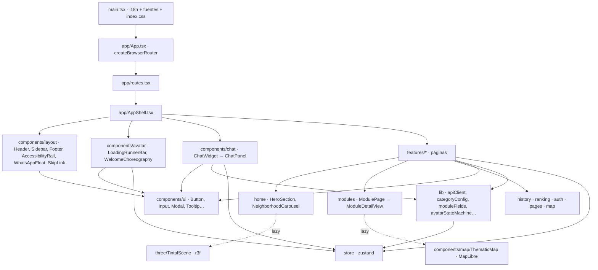
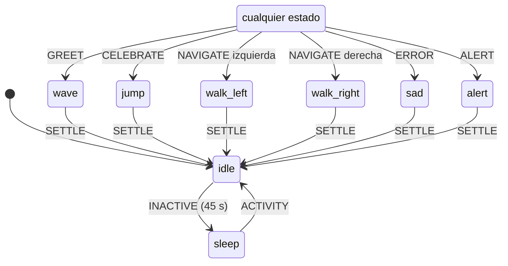

# Diseño del Frontend — Reconoce tu Barrio: El Tintal

Entregable 5 de `docs/origen/PROMPT_MAESTRO.md` §6. Este documento describe el código de `barrio-frontend/` en el commit `7fa5ec4` (H29). La página `/mapa` se está construyendo en estos días y sus cambios aún no tienen commit (ver §5.3). Todas las rutas de archivo son relativas a `barrio-frontend/`. Las decisiones Dn y los hitos Hn remiten a `PLAN_MAESTRO.md`.

## 1. Objetivos y restricciones

| Restricción | Cómo se cumple | Dónde se comprueba |
|---|---|---|
| Paleta oficial (`#0B131E`, `#0B1E38`, `#8AB4F8`, `#1D4ED8`, `#3B82F6`), sus opacidades, blanco, negro y tres colores semánticos | Los colores se declaran una sola vez como variables en `src/styles/tokens.css`. El resto del código usa esos roles. | `src/styles/tokens.test.ts`: cada hex y cada `rgb()` de los `.css` de `src/` debe pertenecer a una lista cerrada |
| Sin hex sueltos en los componentes | Ningún `.tsx` escribe un hex. MapLibre y three leen los colores en tiempo de ejecución con `src/lib/cssToken.ts` (`paletteColor()`) | `tokens.test.ts` («los componentes no escriben hex sueltos») |
| Contraste WCAG AA | Hay 11 pares de texto y fondo, y cada uno debe dar ≥ 4,5:1. El anillo de foco debe dar ≥ 3:1. Se prueba en modo estándar y en alto contraste | `tokens.test.ts` + `src/test/colorMath.ts` (D30, D32) |
| Contenido exento de la paleta (D8) | Hay contenido que no sigue la paleta: la bandera de Kennedy (`public/assets/flags/bandera_kennedy.svg`, descrita en `src/features/history/KennedyFlag.tsx`), las fotos del carrusel (`public/assets/photos/carrusel/`), el sprite de Mini Marie (el único amarillo) y los emojis de las categorías. Todo vive en `public/` o es contenido, no estilo | La prueba de tokens recorre solo `src/`. H27 descartó dibujar la bandera como SVG en línea porque metía hex en `src` |
| Ningún archivo de código pasa de 100 líneas | Cada archivo tiene una sola responsabilidad: hooks aparte, CSS por componente y datos en JSON | `scripts/check_line_length.mjs` (`.ts .tsx .js .mjs .css`; excluye `node_modules`, `dist`, `coverage`, JSON) |
| TypeScript estricto | `tsconfig.json`: `strict`, `noUncheckedIndexedAccess`, `exactOptionalPropertyTypes`, `noUnusedLocals/Parameters`, `verbatimModuleSyntax` | `npm run typecheck` (`tsc --noEmit`) |
| Sin recursos externos | Las fuentes son locales (`@fontsource`, `src/styles/fonts.ts`), las fotos son WebP locales y el mapa no usa teselas externas (D5) | `DEPLOY.md` («Servicios externos: ninguno») |

## 2. Design tokens y paleta

### 2.1 Colores

En `src/styles/tokens.css` la paleta base lleva prefijo propio (`--palette-ink|navy|sky|cobalt|azure`) para no chocar con los espacios de nombres de `@theme` de Tailwind 4 (D30). Encima de esa base se definen roles:

| Rol | Valor estándar | Alto contraste (`contrast.css`) | Uso |
|---|---|---|---|
| `--bg-primary` | ink `#0B131E` | `#000000` | `body`, fondo y niebla de la escena 3D |
| `--bg-surface` | navy `#0B1E38` | `#000000` | Tarjetas, sidebar, modales, panel del chat |
| `--accent-soft` | sky `#8AB4F8` | `#ffffff` | Iconos, enlaces, bordes luminosos |
| `--interactive-primary` | cobalt `#1D4ED8` | cobalt | Botón primario, pista de la barra de carga |
| `--interactive-hover` | `color-mix(cobalt 82 %, azure)` | `#000000` | Hover del primario. Blanco sobre azure puro da ≈ 3,7:1 y no llega a AA (D30) |
| `--interactive-active` | azure `#3B82F6` | — | Activo, foco y marcador seleccionado |
| `--text-primary / -secondary / -muted` | blanco / sky / sky 78 % | blanco | Texto |
| `--border-subtle / -strong`, `--hairline` | sky 18 % / 45 % / 10 % | sky / blanco / sky | Bordes |
| `--glass-fill`, `--glass-blur` | sky 6 %, 16 px | negro, 0 px | Clase `.glass` (`src/styles/index.css`) |
| `--focus-ring` | azure | blanco | `:focus-visible` 2 px (3 px en alto contraste) |
| `--state-success / -warning / -error` | `#34d399` / `#fbbf24` / `#f87171` | sin cambio | Insignias de verificación, avisos y errores |

`src/styles/index.css` expone estos roles como utilidades de Tailwind con `@theme inline` (`bg-surface`, `text-fg-muted`, `border-line-strong`…). Como las utilidades apuntan a las variables, el alto contraste cambia toda la interfaz solo con poner una clase en `<html>`.

Hay dos excepciones con color fijo, ambas dentro de la paleta. Las estrellas usan relleno azure y borde sky (D13, `src/components/ui/stars.css`). El confeti de la bienvenida solo usa azules (D6, `src/components/avatar/welcome.css`).

### 2.2 Tipografía

| Token | Familia | Pesos cargados (`fonts.ts`) | Uso |
|---|---|---|---|
| `--ff-display` | Space Grotesk | 500, 700 | `h1–h3` |
| `--ff-body` | Inter | 400, 500, 600 | Cuerpo |
| `--ff-mono` | JetBrains Mono | 400 | Coordenadas, m², telemetría del HUD, insignias |
| `--ff-pixel` | Press Start 2P | 400 | Solo Mini Marie: cabecera del chat y letrero «Hola» (`src/styles/pixel.css`) |

Solo se carga el subconjunto `latin`, que cubre español e inglés (D32). La escala es fluida y va de `--step--1` a `--step-4` (`clamp()`). El tamaño de letra del usuario es `html { font-size: calc(100% * var(--font-scale)) }`, así que todas las medidas en `rem` escalan con la barra de accesibilidad (§10).

### 2.3 Espaciado, radios, sombras y movimiento

| Grupo | Tokens |
|---|---|
| Espaciado | `--space-1…16` = 4/8/12/16/24/32/48/64 px |
| Radios | `--r-sm` 8 px, `--r-md` 12 px, `--r-lg` 16 px (sobrescriben `rounded-sm/md/lg` de Tailwind) |
| Duraciones | `--dur-1…5` = 120/180/240/320/480 ms |
| Curvas | `--ease-emphasis` `cubic-bezier(0.22, 1, 0.36, 1)`; `--ease-drawer` `cubic-bezier(0.32, 0.72, 0, 1)` para el cajón móvil (H26) |
| Estados | `--press-scale` 0.97, `--disabled-opacity` 0.45 |
| Elevación | `--shadow-deep`, `--glow-active` |
| Resorte | `--spring-stiffness` 260, `--spring-damping` 24. Están declarados pero ningún archivo los lee (ver §13) |

Con movimiento reducido, sea del sistema o de la clase `.reduce-motion`, los tokens pasan a `--press-scale: 1` y `--dur-4/5: 120ms`. Desaparecen escalas y desplazamientos y se conservan los fundidos cortos.

## 3. Arquitectura de carpetas y micro-módulos

| Carpeta | Responsabilidad | Ejemplos |
|---|---|---|
| `src/app/` | Composición: router, árbol de rutas compartido con las pruebas y `AppShell` | `routes.tsx`, `AppShell.tsx` |
| `src/features/<dominio>/` | Páginas y piezas de un dominio. Un dominio no importa a otro salvo por componentes de página | `modules/` (lista, filtros, ficha, formulario, galería, calificaciones), `history/`, `ranking/`, `auth/`, `home/`, `pages/`, `faq/`, `profile/`, `map/` |
| `src/components/ui/` | Design system sin dependencias de dominio | `Button`, `Input`, `Card`, `Modal`, `Tooltip`, `Accordion`, `Spinner`, `Skeleton`, `Stars`, `StarsInput`, `useFocusTrap` |
| `src/components/layout/` | Estructura común | `Header`, `Sidebar`, `CategoryMenu`, `Footer`, `AccessibilityRail`, `WhatsAppFloat` |
| `src/components/avatar/`, `chat/`, `map/` | Mini Marie, chat y mapa temático | ver §6 y §7 |
| `src/three/` | Escena 3D (r3f), proyección y geometría | `TintalScene`, `extrude.ts`, `projection.ts` |
| `src/lib/` | Lógica pura y configuración | `apiClient.ts`, `loadingTracker.ts`, `avatarStateMachine.ts`, `categoryConfig.ts`, `moduleFields.json`, `chatLocalReplies.ts`, `cssToken.ts`, `pagesProxy.ts` |
| `src/store/` | Estado global (zustand) | ver §8 |
| `src/hooks/` | Hooks transversales | `useApi`, `useApplyA11y`, `useReducedMotion`, `useMediaQuery`, `useLoadingProgress`, `usePersistentFlag` |
| `src/i18n/` | Recursos ES/EN | `es.json`, `en.json`, `content.en.json` |
| `src/test/` | Utilidades de prueba | `renderRoute.tsx`, `mockApi.ts`, `maplibreMock.ts`, `colorMath.ts`, fixtures |

Dos fuentes únicas evitan que el código se duplique entre los 14 módulos:

- `src/lib/categoryConfig.ts` define, para cada módulo, el id oficial, el *slug* (que también es ruta y clave i18n), el emoji y el tipo de geometría (`POINT`, `POLYGON`, `LINESTRING` o `FICHA`).
- `src/lib/moduleFields.json` (D54) define los campos, los filtros, el orden y el resumen de cada módulo, y refleja los esquemas del backend.

Con esas dos fuentes, una sola `ModulePage` sirve `/categorias/:slug` para los 14 módulos (`src/features/modules/ModulePage.tsx`). El formulario se arma desde los campos con zod (`formSchema.ts`), y los puntos se validan contra el bbox de El Tintal (`TINTAL_BBOX`).

### 3.1 Rutas y carga diferida

`src/app/routes.tsx` genera las rutas desde `src/lib/navigation.ts`. Cada sección del Sidebar usa su página dedicada o, si aún no la tiene, `SectionPage` («En construcción», D62). Desde D66 ninguna sección la usa: `/galeria` es `GalleryPage` (`src/features/gallery/`), y `SectionPage` queda como respaldo para una sección nueva.

| Ruta | Componente | Carga |
|---|---|---|
| `/` | `HomePage` | chunk inicial |
| `/historia` | `HistoryPage` | chunk inicial. En diferido su LCP empeoraba de 3,1 a 3,7 s (H27) |
| `/categorias/:slug` | `ModulePage` | `lazy` |
| `/mapa`, `/ranking`, `/preguntas`, `/creadora`, `/ayuda`, `/acceso`, `*` | `MapPage`, `RankingsPage`, `FaqPage`, `CreatorPage`, `HelpPage`, `AccessPage`, `NotFoundPage` | `lazy` |
| `/galeria` | `SectionPage` | `lazy` |

`AppShell` envuelve el `<Outlet />` en `<Suspense fallback={<LoadingTask />}>`, así que cada descarga de ruta mueve la barra de carga (§7.5). La escena 3D (`HeroSection` → `lazy(() => import('../../three/TintalScene'))`) y el mapa (`ModuleDetailView` → `lazy(... ThematicMap)`) también son chunks aparte. Resultado medido en H27: el chunk inicial bajó de 226 a 115 kB gz, el mapa pesa 296 kB gz y la escena 3D 221 kB gz.

## 4. Componentes UI y sus 5 estados

Las reglas compartidas están en `src/components/ui/ui.css`:

| Estado | Implementación |
|---|---|
| hover | Solo con `@media (hover: hover) and (pointer: fine)`. El primario cambia a `--interactive-hover` + `--glow-active`; secundario y ghost cambian el borde a `--interactive-active` |
| focus-visible | `outline: 2px solid var(--focus-ring)` global (`index.css`). En campos: borde y anillo de 2 px |
| active / pressed | `.ui-pressable:active` → `scale(var(--press-scale))` (0,97, o 1 con movimiento reducido) |
| disabled | `opacity: var(--disabled-opacity)` y `pointer-events: none` |
| loading | `aria-busy="true"`, `cursor: progress` y `Spinner` local o `Skeleton` |

| Componente | Notas de diseño |
|---|---|
| `Button` | Variantes `primary`, `secondary` y `ghost`; tamaños `sm` (36 px) y `md` (44 px). Con `loading` muestra el spinner y bloquea el clic sin perder el foco (`aria-disabled`) |
| `Input` | Etiqueta visible obligatoria. `hint` y `error` van enlazados con `aria-describedby`. El error lleva `role="alert"` y `aria-invalid` |
| `Modal` | Portal, `aria-modal`, trampa de foco (`useFocusTrap`), cierre con Escape o clic fuera, bloqueo del scroll y foco devuelto al disparador. Entra con `@starting-style` (opacidad + escala), sin JS (`ui-motion.css`) |
| `Tooltip` | Se abre por hover (400 ms por defecto) o por foco (al instante). Se cierra con Escape. Tiene un grupo «caliente» de 300 ms: al recorrer botones vecinos, solo el primero espera (H26) |
| `Accordion` | Patrón WAI-ARIA: botón con `aria-expanded` y región `role="region"`. El panel usa `hidden` para que Ctrl+F lo encuentre (H26) |
| `Card` | `.glass` + `--shadow-deep` |
| `Skeleton`, `Spinner` | `role="status"` con texto i18n. El brillo del skeleton y el pulso de WhatsApp se apagan con movimiento reducido |
| `Stars`, `StarsInput` | Solo lectura con relleno parcial. La entrada usa 10 radios nativos (de 0,5 a 5), así funcionan las flechas del teclado. Al marcar, la estrella rebota (`stars-pop`, 420 ms), salvo con movimiento reducido |

`src/components/ui/ui.a11y.test.tsx` corre axe-core sobre todos esos estados y sobre el modal abierto. La regla `color-contrast` va desactivada porque jsdom no calcula layout; el contraste se prueba en `tokens.test.ts` (D32).

## 5. Escena 3D (`src/three/`)

### 5.1 Datos y geometría

`useTintalData.ts` pide el mapa base compartido (`components/map/baseMapData.ts`: polígono más las capas `manzanas`, `parques`, `vias` y `edificios`, servidas por `/api/v1/barrio/*` y cacheadas por sesión) y `/centros-educativos/geojson`. Si fallan los lugares, la maqueta igual se muestra.

| Pieza | Diseño |
|---|---|
| `projection.ts` | Proyección equirectangular local (lon/lat → metros en x/z) con origen en el centro del bbox |
| `extrude.ts` | Cada capa de polígonos se funde en **una** `BufferGeometry` extruida (una draw call por capa). Cada vértice lleva `featureId` para saber qué edificio está bajo el puntero |
| `GroundLayer` | Huella del polígono, manzanas como zócalos de 2 m y parques a 1,2 m. OSM no trae la altura de las manzanas (D44) |
| `BuildingsLayer` | La altura sale de `building:levels`/`height` de OSM × 3,2 m, con 3 pisos si falta el dato (`metrics.ts`). El color de los vértices degrada de navy a cobalt según la altura, las aristas son sky (`EdgesGeometry`) y el edificio bajo el puntero se resalta en azure |
| `RoadsLayer` | Vías como cintas planas (`ribbons.ts`). Las principales llevan núcleo ink y filo azure; las locales, trazo sky tenue |
| `Particles` | 420 puntos sky con generador determinista (sin `Math.random`). Quietos con movimiento reducido |
| `Billboards` | Botones HTML reales (`drei <Html>`), enfocables y con nombre accesible. Hoy solo para Centros Educativos (🎓) |
| `sceneColors.ts` | Toma los colores de `paletteColor()`: la escena no contiene hex |

### 5.2 Cámara, interacción y rendimiento

- `CameraRig.tsx` hace una órbita automática a 0,035 rad/s. Se detiene si el puntero está sobre el lienzo (`heroStore.interacting`) o si el usuario la pausa desde el HUD (WCAG 2.2.2).
- La cámara tiene parallax de ≤ 6° con el puntero y un fly-to exponencial e interrumpible (≈ 95 % del recorrido en ≈ 1 s) hacia el lugar elegido. Con movimiento reducido no hay órbita ni parallax y los saltos son directos.
- `HeroHud.tsx` reparte el HUD de vidrio en las esquinas: coordenadas, pausa, telemetría del edificio (tipo, pisos y m², con `aria-live`) y la ficha del lugar con enlace al módulo.
- `HeroSection.tsx` usa un `IntersectionObserver`: con la escena fuera de pantalla pone `frameloop="never"`. Mientras carga muestra un `Skeleton`; si falla, un error con «Reintentar».
- `PerfProbe.tsx` escribe en `[data-hero]` los triángulos y el frame time medio cada 60 cuadros. Medido (D45): 40 352 triángulos (presupuesto < 90 000) y 7,06 ms/cuadro con GPU real. El equipo era de desarrollo, no de gama media.
- Versiones fijas: `@react-three/fiber` 8.18.0, `drei` 9.122.0 y `three` 0.172.0, porque las versiones 9/10 exigen React 19 (D44).

### 5.3 Página `/mapa` (Mapa 3D)

`src/features/map/MapPage.tsx` (FE `2fa647b`, publicado; su prueba corre axe desde `87598ee`). La página reutiliza `HeroSection` con `variant="page"`, que ocupa `calc(100dvh - 12rem)`. Debajo lista los 14 mapas temáticos como enlaces a `/categorias/:slug` y cierra con la nota de definición operativa del territorio. La ruta ya está en `routes.tsx` como `lazy`.

## 6. Mapa temático MapLibre (`src/components/map/`)

| Pieza | Diseño |
|---|---|
| `useMapInstance.ts` | Crea el mapa con `bounds` = bbox del polígono y `maxBounds` = bbox ± 0,04°, sin rotación y con atribución «© OpenStreetMap (ODbL)». El worker se emite con `?url` + `setWorkerUrl()` porque Vite no ve el `import.meta.url` de MapLibre 6 (D43). Tras `load` llama `resize()` y vuelve a encuadrar |
| `baseStyle.ts` | Estilo propio con solo fuentes GeoJSON locales (D5): fondo ink, área navy, manzanas navy con contorno sky, parques azure 16 %, edificios cobalt 55 %, vías sky (más gruesas las principales) y borde punteado sky. Los colores salen de `paletteColor()`, así que respetan el alto contraste |
| `EmojiMarker.ts` + `useMarkers.ts` | Un marcador DOM por punto: `<button>` con `aria-label` (nombre del registro) y el emoji de `categoryConfig` en `aria-hidden`. El texto se escribe con `textContent`, nunca con `innerHTML`. Los datos no verificados llevan borde punteado y el seleccionado lleva `aria-current`, escala 1,12 y `--glow-active`. La cámara hace `flyTo` de 1000 ms (`essential: false`), o `jumpTo` con movimiento reducido |
| `useShapes.ts` | Polígonos y líneas del módulo (zonas, lotes, calles) en una fuente propia. Selección por `feature-state`, clic para elegir y `fitBounds` hacia el seleccionado |
| `ThematicMap.tsx` | Región con nombre accesible, `Skeleton` mientras carga y error con «Reintentar» |
| `map.css` | Selector más específico que `maplibre-gl.css` para que el mapa no quede con alto 0 (D43). Controles en la paleta |

`ModuleDetailView` muestra la lista filtrable y el mapa uno al lado del otro. Seleccionar en la lista mueve el mapa, y elegir un marcador selecciona el registro.

## 7. Mini Marie

### 7.1 Sprite

`scripts/slice_spritesheet.mjs` y sus módulos en `scripts/sprite/` recortan una copia del spritesheet; `MINI MARIE.png` no se toca. Salen `public/assets/avatar/frame_1..6.png` y `atlas.json`, con `footX`/`footY`/`offsetY` por pose. El atlas se copia también en `src/components/avatar/` porque Vite no importa desde `public/`; una prueba comprueba que ambas copias coinciden (D47). `avatarLayout.ts` pone los pies de todas las poses en la misma línea base, así cambiar de frame no hace saltar el avatar. `AvatarSprite.tsx` pinta los frames del estado con `.pixel-art` (`image-rendering: pixelated`) y anima solo `transform`/`opacity` en `avatar.css` (más un filtro de saturación en `sad`).

### 7.2 Máquina de estados

`src/lib/avatarStateMachine.ts` es una función pura `transition(state, event)` sin temporizadores. `src/store/avatarStore.ts` la guarda en zustand, y `useAvatarSettle()` despacha `SETTLE` cuando se cumple el `holdMs` del estado.

| Estado | Frames | frameMs | holdMs | Animación CSS |
|---|---|---|---|---|
| `idle` | 1 ↔ 2 | 1100 | — | Alternancia + respiración de 2 px |
| `walk_left` / `walk_right` | 3 / 4 | 150 | 1200 | Paso de 3 px |
| `wave` | 5 | 450 | 1800 | Balanceo ±6° |
| `jump` | 6 | 900 | 900 | −18 px con overshoot |
| `sad` | 1 | 1600 | 1600 | −10° y desaturación |
| `alert` | 2 | 1200 | 1200 | Vibración horizontal de ±3 px |
| `sleep` | 1 | 1100 | — | Burbuja «zZz» |
| `run` | 4 ↔ 2 | 150 | — | Solo en la barra de carga. Ninguna transición lleva aquí |

Quién dispara cada evento:

| Evento | Origen |
|---|---|
| `NAVIGATE` | `components/chat/useChatReactions.ts`: compara la posición de la ruta nueva con la anterior en el orden del menú |
| `ALERT` | Entrar en `/categorias/robos`, una respuesta del chat con `expresion: alert` o una respuesta local de robos |
| `INACTIVE` / `ACTIVITY` | 45 s sin `pointerdown`, `pointermove`, `keydown`, `scroll` ni `touchstart` / actividad posterior |
| `GREET` | Abrir el chat, una respuesta `wave` o una respuesta local que no es de robos |
| `CELEBRATE` | Guardar un lugar (`CrudFormModal`), guardar una calificación (`RatingForm`) o una respuesta `jump` |
| `ERROR` | Un error de escritura que no es de sesión (`WriteError`, `RatingForm`) o una respuesta `sad` |

Con movimiento reducido (`avatar-reduced.css`) el avatar no oscila ni se desplaza. Cada estado muestra su frame quieto, así que la información del estado se conserva.

### 7.3 Bienvenida

`WelcomeChoreography.tsx` + `welcomeTimeline.ts` (GSAP, D47) + `welcomeGeometry.ts`:

- Entran ocho Mini Marie en `wave`, una desde cada esquina, desde los laterales y desde el centro arriba y abajo. Cada una tiene un desfase de 0 a 60 ms, entra con `elastic.out` y termina en un anillo que no tapa el letrero.
- El letrero «Hola» (Press Start 2P) aparece letra a letra, con stagger de 80 ms, de `blur(8px)` a nitidez y escala elástica. Lo acompañan 28 piezas de confeti azul y el botón «¡Hola! Explorar El Tintal».
- Se cierra sola a los 3,8 s, o antes con el botón, un clic fuera o Escape. La salida dura 200 ms. Al montarse de nuevo, `timeline.kill()` evita que se apilen dos coreografías.
- Es un `role="dialog"` modal con trampa de foco. El letrero se anuncia una sola vez (`sr-only`), no letra por letra.
- `welcomeStore.ts` guarda el flag `mini-marie:welcome-seen` en `sessionStorage` (D11), y el header tiene un botón «Repetir bienvenida».
- Con movimiento reducido todo aparece junto con un fundido de opacidad de 200 ms, sin confeti.

### 7.4 Chat conectado y respaldo local

| Pieza | Diseño |
|---|---|
| `ChatWidget.tsx` | Lanzador con el avatar en vivo, a la izquierda del botón de WhatsApp (D48). Al abrir manda el saludo contextual con el nombre de la sección (`placeKeyOf`) y pasa el foco al campo. Al cerrar, el foco vuelve al lanzador |
| `ChatPanel.tsx` | `role="dialog"` no modal (`aria-modal="false"`, sin trampa de foco), sobre `--bg-surface` opaco (D48). Conversación en `role="log"`. La espera («Mini Marie está buscando en los datos del barrio…») se anuncia con `aria-live="polite"` |
| `ChatBubble.tsx` | Burbuja pixel (`.pixel-bubble`) con *typewriter* de 2 caracteres cada 16 ms (`useTypewriter.ts`). El lector de pantalla recibe el texto completo de una vez. El texto del servidor se pinta como texto, nunca como HTML. Las acciones rápidas son `<Link>` internos |
| `ChatSuggestions.tsx` | Chips con las sugerencias del servidor; si no hay, cuatro fijas de i18n. Se desactivan mientras hay una pregunta pendiente |
| `store/chatStore.ts` | Una pregunta a la vez (`pending`). Llama a `askMarie()` (`lib/chatApi.ts` → `POST /api/v1/chat` con `{mensaje, idioma, ruta}`, D60). La `expresion` de la respuesta se traduce a un evento del avatar |
| Respaldo | Si la red falla o pasan los 15 s de `apiClient`, responde `localReply()` (`lib/chatLocalReplies.ts`): raíces ES/EN sin tildes por módulo que devuelven **claves i18n** y una acción rápida, con la nota «Sin conexión con el servidor: respuesta del repertorio local.». Un 429 del servidor responde `chat.replies.limit` y no inventa una respuesta (D62) |

### 7.5 Barra de carga (`LoadingRunnerBar`)

El progreso es real y se mide por etapas (D61):

1. `lib/loadingTracker.ts` registra cada petición de `apiClient` como una tarea: 10 % al enviarla, 35 % al recibir las cabeceras y de ahí a 100 % según los bytes leídos frente a `Content-Length`.
2. `LoadingTask` registra cada chunk diferido al 30 % mientras está montado como *fallback* de Suspense. El mapa además queda al 50 % hasta su evento `load`.
3. `store/loadingStore.ts` promedia el lote. Las tareas terminadas quedan en 1 para que la barra no retroceda, y el lote se vacía cuando todo termina.
4. `hooks/useLoadingProgress.ts` mantiene la barra visible al menos 650 ms. Al terminar marca 100 % y la oculta tras 240 ms.

`/auth/session` y `/chat` no mueven la barra porque tienen su propio indicador o son casi instantáneas (`QUIET`). La barra es un `role="progressbar"` con `aria-valuenow`, `pointer-events: none` y `z-index: 90`. La pista es cobalto y el relleno azure (`scaleX`, lineal). Mini Marie corre en estado `run` sobre el borde del relleno (`translateX`). Con movimiento reducido no hay transiciones ni alternancia de frames.

## 8. Estado global y cliente HTTP

| Store (`src/store/`) | Contenido | Persistencia |
|---|---|---|
| `a11yStore` | `highContrast`, `scaleIndex` (90/100/112,5/125 %) y `reducedMotion` (por defecto, el valor del sistema) | `localStorage` `mini-marie:a11y` (`persist` + `partialize`) |
| `authStore` | `status` (`checking`, `anonymous` o `signedIn`), `user` (id, correo, nombre, rol) y `dialogOpen` | Solo en memoria. El token nunca llega al JS (D58) |
| `avatarStore` | Estado de Mini Marie y `dispatch` | Memoria |
| `chatStore` | `open`, `messages` y `pending` | Memoria |
| `loadingStore` | Tareas de carga en curso y su avance | Memoria |
| `welcomeStore` | `open`, `openIfFirstVisit`, `replay` y `close` | `sessionStorage` |
| `three/heroStore` | Pausa, interacción, edificio bajo el puntero y lugar elegido en la maqueta | Memoria. Vive junto a la escena |

Los componentes leen los stores con selectores por campo, por ejemplo `useWelcomeStore((s) => s.open)`, para no volver a pintarse por cambios ajenos (H29). Las acciones que no pintan nada usan `getState()`, como `useAvatarStore.getState().dispatch(...)`.

**Cliente HTTP** (`src/lib/apiClient.ts`):

- La base es `VITE_API_URL` o `/api/v1`, del mismo origen. En desarrollo y en *preview*, Vite reenvía `/api` a `127.0.0.1:8000` (`vite.config.ts`).
- `apiGet` combina la señal del llamador con `AbortSignal.timeout(15 s)`. `apiSend` cubre `POST`, `PATCH` y `DELETE`, y un 204 devuelve `undefined`.
- Todo error se convierte en `ApiError(status, code, message)` desde el formato único del backend `{"error": {code, message}}`. Un fallo de red da `NETWORK_ERROR` con `status` 0.
- `hooks/useApi.ts` es la capa declarativa: estados `loading`, `success` y `error`, cancelación de la petición anterior al cambiar la clave y `retry()`. Las páginas pintan los cuatro casos: cargando (`Skeleton`), error con reintento, vacío y datos (por ejemplo `features/modules/ModuleList.tsx`).

## 9. Internacionalización ES/EN

- `src/i18n/i18n.ts` inicializa i18next de forma síncrona (`initAsync: false`). El idioma por defecto y de respaldo es español, y el elegido se guarda en `localStorage` (`mini-marie:lang`).
- `<html lang>` sigue al idioma activo. `LanguageSwitcher.tsx` es un grupo de dos botones con `aria-pressed` y el nombre del idioma en `sr-only`.
- Los recursos son `es.json` y `en.json` en el *namespace* `translation`. `i18n.test.ts` exige que ambos tengan las mismas claves.
- **Namespace `content`** (solo inglés, `content.en.json`): traduce textos que la API entrega en español, hoy los hitos de la historia. `features/history/Timeline.tsx` pide `content:history.<año>-<orden>.title` con `defaultValue` = el texto de la API. En español se ve el texto de la API tal cual, y en inglés la traducción si existe.
- El chat local devuelve claves, no textos, así que cambia de idioma con la interfaz. El servidor responde en el `idioma` pedido (D60). Los números se formatean con `Intl.NumberFormat` y `toLocaleString` (`es-CO` / `en-US`).

## 10. Accesibilidad

| Aspecto | Implementación |
|---|---|
| Barra de accesibilidad | `components/layout/AccessibilityRail.tsx` va fija a la derecha y en móvil se pliega con un botón disclosure. Ofrece A−/A+ con el porcentaje anunciado en `role="status"`, alto contraste y movimiento reducido (`aria-pressed`) y restablecer. `hooks/useApplyA11y.ts` aplica `.high-contrast`, `.reduce-motion` y `--font-scale` en `<html>`. Los iconos de A−/A+ no llevan texto para que el nombre accesible sea solo la etiqueta (WCAG 2.5.3, D49) |
| Alto contraste | `src/styles/contrast.css` redefine los roles: fondos negros, texto blanco, bordes sólidos, sin vidrio ni sombras, enlaces subrayados y foco de 3 px |
| Movimiento reducido | Se activa por dos vías: `@media (prefers-reduced-motion: reduce)` y la clase `.reduce-motion`. Cubre los tokens de duración y escala, el avatar, el chat, el skeleton, el pulso de WhatsApp, las estrellas, la barra de carga, la cámara 3D, MapLibre, la bienvenida y los reveals de la Historia. `hooks/useReducedMotion.ts` combina el sistema y la barra |
| Teclado | `SkipLink` («Saltar al contenido principal») es el primer Tab y lleva a `<main id="contenido" tabIndex={-1}>`. El cajón móvil, los modales y la bienvenida tienen trampa de foco (`useFocusTrap`). El chat se cierra con Escape y devuelve el foco. Los tooltips se abren con foco. Los marcadores del mapa y los billboards 3D son `<button>`. El carrusel tiene pausa, flechas y teclado (`NeighborhoodCarousel.tsx`) |
| Semántica | Sidebar con `NavLink` y `aria-current="page"`. Submenú «Categorías» como disclosure. Estados de carga con `role="status"` y errores con `role="alert"` |
| Objetivos táctiles | Los controles principales miden ≥ 44 px (`min-h-11`, `size-11`) |
| axe | Por un lado, en jsdom (`ui.a11y.test.tsx` y pruebas de página) con `color-contrast` desactivado y el contraste calculado aparte (D32). Por otro, en Edge real con backend: 12 vistas × 4 modos (ES/EN, estándar/alto contraste, escritorio/móvil, letra al 125 % y movimiento reducido) dieron **0 violaciones** de WCAG 2.0/2.1 A y AA (H28). El script de ese barrido no está versionado |

## 11. Sesión y roles en la UI

- La sesión es un JWT en la cookie httpOnly `mm_session` (SameSite=Strict, Path=/api). El JS no la lee (D58).
- Al montar `AppShell`, `restoreSession()` llama `GET /auth/session`, que responde 200 también sin sesión para que la consola quede limpia.
- `authApi.ts` expone `login`, `register` (siempre crea un visitante) y `logout`.
- `LoginModal` (en `AppShell`) se abre desde `AccountButton` en el header o desde `LoginPrompt` dentro de una acción. `/acceso` muestra los formularios o, con sesión iniciada, la cuenta, lo que permite su rol y el botón para cerrar sesión.
- `features/auth/AuthGuard.tsx` muestra contenido según el rol:

| Rol | Ve | Componente |
|---|---|---|
| Anónimo | Lista, mapa, ficha, galería y ranking. En calificaciones, «Para calificar necesitas iniciar sesión.» con botón para iniciarla | `RatingPanel` (`fallback`) |
| `visitante` (`role="user"`) | Lo anterior + formulario de calificación | `RatingPanel` → `RatingForm` |
| `admin` | Lo anterior + «Agregar lugar», «Editar» y «Eliminar» con confirmación en el mismo lugar | `ModuleDetailView`, `ItemDetailModal` → `ItemActions` |

`AuthGuard` solo ordena la interfaz; quien protege los datos es la API (`require_admin`/`require_user`). Si una escritura recibe 401, `WriteError` llama `authStore.expire()`, que cierra la sesión local y abre el diálogo. Un 403 o cualquier otro error muestra el mensaje traducido (`forms.errors.<code>`).

## 12. Publicación (Cloudflare Pages + proxy)

| Pieza | Diseño |
|---|---|
| Build | `npm run build` = `tsc --noEmit && vite build` → `dist/`. `NODE_VERSION` 24 (`.nvmrc`, `DEPLOY.md`) |
| Proxy | `functions/api/[[path]].ts` es una Pages Function que reenvía todo `/api/*` a `proxyToBackend()` (`src/lib/pagesProxy.ts`, D62). El navegador solo habla con el dominio de Pages, así la cookie sigue siendo de mismo origen y no hace falta CORS con credenciales |
| Seguridad del proxy | Borra `host`, `x-proxy-secret` y `x-client-ip` de la petición entrante. Con `PROXY_SECRET` agrega la clave y la IP real (`cf-connecting-ip`) para los límites de intentos del backend. `redirect: 'manual'`. Responde 503 `BACKEND_NOT_CONFIGURED` si falta `BACKEND_URL` y 502 `BACKEND_UNAVAILABLE` si el backend no contesta (Render free despierta lento). Lo prueba `pagesProxy.test.ts` |
| SPA | Pages sirve `index.html` para las rutas porque no hay `404.html` (`DEPLOY.md`) |
| Cabeceras | `public/_headers`: `X-Content-Type-Options: nosniff`, `X-Frame-Options: DENY`, `Referrer-Policy` y `Permissions-Policy` sin cámara, micrófono ni geolocalización |
| Producción | https://reconoce-el-tintal.pages.dev con despliegue directo por `wrangler`; secretos `BACKEND_URL` y `PROXY_SECRET` (D64). Guía completa en `docs/PUBLICACION.md` |

## 13. Deudas y diferencias conocidas

| Tema | Estado en el código |
|---|---|
| `text-step--2` | Lo usan `ChatPanel.tsx` y `ChatBubble.tsx`, pero ni `tokens.css` ni `@theme` definen `--step--2`. Tailwind no genera esa clase y esos textos heredan el tamaño del contenedor |
| Resorte | `--spring-stiffness`/`--spring-damping` están declarados y nada los usa. Los rebotes son `cubic-bezier(0.34, 1.56, 0.64, 1)` en CSS (estrellas, `jump`) y `elastic.out` en GSAP (bienvenida) |
| Movimiento reducido del sistema | `ThematicMap`, `Timeline` y `CountUp` solo leen `a11yStore.reducedMotion`, que se inicializa con la preferencia del sistema pero se guarda en `localStorage`. `HeroSection` y `useReducedMotion` combinan ambas fuentes |
| Literales de movimiento | Algunas duraciones son literales en vez de tokens: spinner 700 ms, skeleton 900 ms, pulso 2400 ms, estrellas 420 ms y barra de carga 240 ms. El fundido final de la barra usa `--dur-2` (180 ms) aunque el componente espera 240 ms |
| Billboards 3D | Solo Centros Educativos, con el emoji 🎓 escrito en `TintalScene.tsx` en vez de leerlo de `categoryConfig` |
| Fotos | La galería del frontend es de solo lectura. El comentario de `AuthGuard` menciona «fotos» para admin, pero no hay interfaz para subirlas |
| Celebrar | `RatingForm` celebra cualquier calificación guardada (D60). `PROMPT_MAESTRO` §11.4.2 pide celebrar con ≥ 4,5 estrellas |
