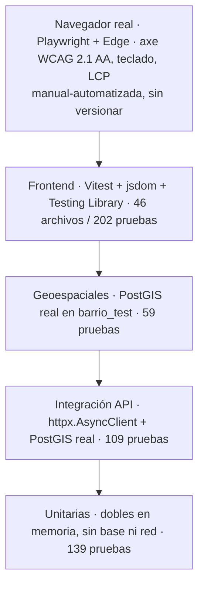

# Estrategia de pruebas — Reconoce tu Barrio: El Tintal

Estado tras H29 (Fase 3). Los números de las secciones 2, 3 y 5 se midieron al escribir este documento sobre BE `5a2ef0a` (con cambios locales sin confirmar en el árbol de trabajo) y FE `2fa647b`. Los resultados en navegador real (sección 4) vienen de `PLAN_MAESTRO.md` (H14, H25, H27, H28): se ejecutaron con scripts que no están versionados y no se repitieron aquí.

Requisito del curso (`docs/origen/PROMPT_MAESTRO.md` §6.4 y §14): pirámide de pruebas, cobertura PyTest ≥ 80 %, pruebas de geometrías PostGIS, Vitest + Testing Library en el frontend y `axe-core` con 0 violaciones WCAG AA.

## 1. Pirámide de pruebas



| Nivel | Dónde | Herramienta | Cantidad medida | Qué prueba |
|---|---|---|---|---|
| Unitarias | `barrio-backend/tests/unit/` (19 archivos) | pytest, dobles | 139 | Intenciones del chat, `AnalyticModel`, `GenerativeModel`, `MoERouter`, `ClaudeTextGenerator`, esquemas GeoJSON, seguridad JWT/bcrypt, configuración de producción, clientes Overpass y Datos Abiertos, mapeos del ETL, contrato de semillas |
| Integración API | `barrio-backend/tests/api/` (11 archivos) | `httpx.AsyncClient` + `ASGITransport`, PostGIS real | 109 | CRUD de los 14 módulos, 401/403/404/409/422/429, auth y cookie, chat, calificaciones, ranking, galería, historia, `/health` |
| Geoespaciales | `barrio-backend/tests/geo/` (12 archivos) | SQL con funciones PostGIS sobre `barrio_test` | 59 | `ST_Within` del polígono, `ST_CoveredBy` de capas, ETL (recorte, áreas, longitudes), carga de semillas, migración con SRID 4326 y GIST, repositorio CRUD |
| Frontend | `barrio-frontend/src/**/*.test.ts(x)` (42) y `scripts/sprite/*.test.mjs` (4) | Vitest 5.1.0, jsdom 31.0.1, Testing Library, axe-core 4.14.0 | 202 | Componentes, flujos por ruta completa, tokens y contraste, i18n, cliente de API, máquina de estados de Mini Marie, recorte del sprite |
| Navegador real | Edge con Playwright (`@playwright/test` 1.65.1, `channel: 'msedge'`, D3) | axe-core en página real, recorrido con teclado, LCP | 48 combinaciones axe (H28) | Contraste con layout real, foco visible, rendimiento con red y CPU limitadas |

Backend: 311 pruebas recolectadas (`pytest --collect-only`, tras BE `01d8b78`), 311 pasan; cobertura 98,93 % (`fail_under = 80` en `pyproject.toml`). Las cuentas por nivel incluyen los casos parametrizados.

## 2. Backend (`barrio-backend/`)

### 2.1 Herramientas
pytest 9.2.0, pytest-asyncio 1.5.0 (`asyncio_mode = "auto"`), pytest-cov 7.1.0 y httpx 0.28.1 (`pyproject.toml`, `requirements-dev.txt`). El cliente de API es `httpx.AsyncClient` con `ASGITransport` sobre la app real de `create_app()` (`tests/conftest.py::make_client`); no se usa el `TestClient` de Starlette. Cobertura con `branch = true` y `source = ["app"]`.

### 2.2 Aislamiento de la base
- `tests/conftest.py` fija `POSTGRES_DB=barrio_test` **antes** de importar la app (la configuración está cacheada), así que ninguna prueba toca la base de desarrollo `barrio` (D41).
- La fixture de sesión `test_database` crea la base si falta, activa PostGIS (`tests/db_setup.py::ensure_database`) y la migra con `alembic upgrade head`.
- `db_session` entrega una sesión real y al terminar ejecuta `TRUNCATE … RESTART IDENTITY CASCADE` sobre todas las tablas del proyecto.
- `tests/geo/test_migration.py` usa otra base, `barrio_migration_test`, que crea, migra, baja a `base`, vuelve a subir y borra.
- El PostGIS es el contenedor `postgis/postgis:16-3.4` de `docker-compose.yml`: la suite necesita Docker encendido.

### 2.3 Dobles
| Doble | Archivo | Sustituye a |
|---|---|---|
| `FakeProbe` | `tests/conftest.py` | Sonda de PostGIS; con `version=None` simula la base caída (`client_db_down` → `/health` degradado) |
| `FakeTools` | `tests/unit/chat_fakes.py` | Protocolo `BarrioTools`: datos fijos y registro de llamadas (`calls`) para comprobar qué herramienta usó cada intención |
| `Writer` | `tests/unit/test_generative_moe.py` | Generador de texto del LLM: respuesta fija o `GenerationError` |
| `FakeMessages` + `SimpleNamespace` | `tests/unit/test_claude_generator.py` | Cliente del SDK `anthropic`: guarda la petición enviada y simula `refusal`, texto vacío y `APIConnectionError`; sin red |
| `httpx.MockTransport` | `tests/unit/test_overpass_client.py`, `test_open_data_client.py` | Overpass y datos.gov.co: reintentos, 404, caché |
| `crud_app(as_admin=True)` | `tests/api/crud_app.py` | `require_admin` y `require_user` vía `dependency_overrides`, para probar el CRUD sin pasar por login |

### 2.4 Cobertura
`pytest --cov=app --cov-fail-under=80` → **98,93 %** tras BE `01d8b78` (2329 sentencias, 13 sin cubrir; 192 ramas, 14 parciales), «Required test coverage of 80% reached». El umbral del curso es ≥ 80 %. Historial en `PLAN_MAESTRO.md`: 100 % (H6), 98,56 % (H9–H14), 98,90 % (H25), 98,91 % (H29). La cobertura mide `app/`; el paquete `etl/` se ejercita en `tests/geo` y `tests/unit` pero no entra en el porcentaje.

### 2.5 Geometrías PostGIS
| Archivo | Función PostGIS | Qué se comprueba |
|---|---|---|
| `tests/geo/test_tintal_polygon.py` | `ST_Within`, `ST_IsValid`, `ST_SRID`, `ST_CoveredBy` + `ST_Buffer` | 4 hitos reales (Biblioteca, Ciudad Tintal, El Tintal III, Tintal Plaza) dentro; 3 vecinos (Vereda El Tintal de Fontibón, Corabastos, Castilla) fuera; polígono válido en SRID 4326; vías, parques, edificios y manzanas cubiertos por el polígono + 1 m; trazabilidad OSM |
| `tests/api/test_engagement.py` | `ST_DWithin` sobre `geography` | `/cercania`: un punto a ≈ 111 m entra con distancia entre 105 y 115 m; uno a ≈ 2,2 km queda fuera del radio de 500 m; latitud 95 → 422 |
| `tests/api/test_chat.py` | `ST_DWithin` vía `SqlBarrioTools` | El chat responde «Colegio Alfa (0 m) y Colegio Beta (222 m)» con datos creados por la API |
| `tests/geo/test_etl_geo.py` | recorte por partes, `point_on_surface` | Cuadrado de 0,001° → 12 000–12 500 m²; línea → 105–115 m; lote catastral 1 900–2 100 m² con estrato y sin datos personales; ejemplos reproducibles y dentro del polígono |
| `tests/geo/test_load_seed.py`, `test_import_modules.py` | `ST_Within` en la carga | La carga es idempotente, rechaza lo que cae «fuera de El Tintal» y todas las semillas registradas cargan sin rechazos |
| `tests/geo/test_migration.py` | `geometry_columns`, `pg_indexes` | 14 tablas con su tipo de geometría, SRID 4326, un índice GIST y columnas de auditoría; CHECK de estrellas; downgrade limpio |
| `tests/geo/test_base_crud_repository*.py` | GeoJSON ↔ PostGIS | Ida y vuelta de la geometría, paginación, filtros, búsqueda con comodines como texto, actualización parcial de geometría |

### 2.6 Autenticación (D58)
- `tests/api/test_auth.py`: la cookie `mm_session` sale `HttpOnly`, `SameSite=Strict`, `Path=/api`; mismo 401 para correo desconocido, clave errada y cuenta inactiva, sin `set-cookie`; el registro crea visitante y no acepta `rol`; `logout` borra la cookie; 429 `TOO_MANY_ATTEMPTS` tras los intentos fallidos.
- `tests/api/test_auth_guards.py`: escritura sin sesión → 401 `AUTH_REQUIRED`; visitante → 403 `FORBIDDEN` al crear o borrar, pero califica (201, con su `usuario_id`); admin crea/edita/borra (201/200/204); cuenta desactivada → 401; token vencido, alterado, firmado con otra clave, `alg: none` o basura → 401.
- `tests/unit/test_security.py` y `test_production.py`: hash bcrypt, clave de firma obligatoria, la API no arranca en producción sin `JWT_SECRET` ni con la clave de demostración, y solo el proxy con `PROXY_SECRET` puede declarar la IP real.

### 2.7 Chat: una prueba por intención (H22, D59)
- `tests/unit/test_intents.py`: 20 casos parametrizados (ES/EN) que cubren las 12 intenciones (saludo, ayuda, contacto, categoría, mejor calificado, cercanía, estadísticas, historia, localidad, robos, mapa, desconocido), más el módulo tomado de la ruta actual.
- `tests/unit/test_analytic_model.py` (7 pruebas): el texto de respuesta de cada intención con `FakeTools`, con y sin datos, en los dos idiomas. «Ayuda» solo se prueba en la clasificación, no en el texto de respuesta.
- `tests/unit/test_generative_moe.py` (7) y `test_claude_generator.py` (3 funciones, 5 casos): respaldo analítico sin clave o ante error, el LLM solo cambia el texto y recibe los datos, recorte, MoE por dominio, fábrica por `CHAT_MODEL`.
- `tests/api/test_chat.py`: `POST /api/v1/chat` con PostGIS, 6 entradas inválidas → 422 (incluida `ruta: "javascript:…"` y `rol`), el mensaje 31 del minuto → 429.

## 3. Frontend (`barrio-frontend/`)

### 3.1 Herramientas y configuración
Vitest 5.1.0, jsdom 31.0.1, `@testing-library/react` 16.3.3, `user-event` 14.6.10, `jest-dom` 7.0.1 y `axe-core` 4.14.0. En `vite.config.ts`: `environment: 'jsdom'`, `setupFiles: ['./src/test/setup.ts']`, `include` de `src/**/*.test.{ts,tsx}` y `scripts/**/*.test.mjs`, `css: false`.

`src/test/setup.ts` da la bienvenida por vista, reinicia los stores de sesión y de carga, sustituye `maplibre-gl` por `maplibreMock` (jsdom no tiene WebGL) y limpia el DOM y los globales tras cada prueba.

### 3.2 Utilidades de prueba (`src/test/`)
| Archivo | Uso |
|---|---|
| `mockApi.ts` | Sustituye `fetch`: cada ruta (sin `/api/v1`) responde un cuerpo fijo, calculado o tardío; lo no declarado da 404 con el formato de error del backend. `callsTo` devuelve los parámetros enviados (búsqueda, paginación) |
| `renderRoute.tsx` | Monta la app completa en una ruta con `createMemoryRouter` y el árbol real de `app/routes`; `setViewport` simula escritorio o móvil |
| `authFixtures.ts`, `moduleFixtures.ts`, `engagementFixtures.ts`, `historyFixtures.ts` | Respuestas de ejemplo con la forma del backend |
| `maplibreMock.ts`, `maplibreMapMock.ts` | Doble de MapLibre con el mismo contrato |
| `colorMath.ts` | Contraste WCAG calculado sobre los tokens |

### 3.3 Cobertura de los flujos de §14
| Flujo pedido | Pruebas |
|---|---|
| Sistema de tokens | `src/styles/tokens.test.ts` |
| Barra de accesibilidad (`--font-scale`, contraste, movimiento) | `src/components/layout/AccessibilityRail.test.tsx`: 4 niveles de letra (90–125 %), alto contraste y movimiento reducido en `<html>`, restablecer y persistir, plegado en móvil |
| Calificación por estrellas | `src/features/modules/ItemEngagement.test.tsx`: zod, pasos de 0,5, sin sesión pide iniciarla, 401 reabre el diálogo |
| Chatbot | `ChatWidget.test.tsx`, `ChatRemote.test.tsx` (mensaje + idioma + página, espera sin doble envío, respaldo local sin servidor), `AvatarReactions.test.tsx`, `chatLocalReplies.test.ts` |
| Formulario CRUD | `CrudForm.test.tsx` (crear, editar, eliminar con confirmación, 401), `formSchema.test.ts` |

### 3.4 axe-core en las pruebas (D32)
11 archivos ejecutan `axe.run`: `shell`, `ui.a11y`, `ChatWidget`, `Auth` (LoginModal), `HistoryPage`, `NeighborhoodCarousel`, `GenericModule`, `ItemEngagement`, `ModulePage`, `HelpPage` y `RankingsPage`. La regla `color-contrast` se desactiva porque jsdom no calcula layout ni colores; el contraste se prueba aparte en `tokens.test.ts` (11 pares de texto ≥ 4,5:1 y el anillo de foco ≥ 3:1, en modo estándar y alto contraste: 24 comprobaciones) y con axe completo en navegador real (sección 4).

### 3.5 Resultado medido
`npx vitest run` → **46 archivos, 202 pruebas, todas en verde** (≈ 17–23 s). No hay medición de cobertura en el frontend: no está instalado un proveedor de cobertura de Vitest.

## 4. Auditorías en navegador real

| Hito | Qué | Resultado registrado |
|---|---|---|
| H14 (D49) | axe-core WCAG 2.0/2.1 A + AA en Edge, contraste incluido, backend real: 6 vistas × 2 anchos | 0 violaciones tras corregir 2.5.3 (`label-content-name-mismatch`, que jsdom no detectaba) |
| H25 | axe en Edge: 11 vistas × 2 tamaños | 0 violaciones, 0 errores de consola |
| H28 | axe WCAG 2.0/2.1 A y AA en Edge, backend real: 12 vistas (inicio, 2 módulos, ficha, historia, ranking, acceso, ayuda, preguntas, creadora, mapa, chat abierto) × 4 modos (normal ES escritorio; alto contraste EN móvil; alto contraste ES escritorio con letra 125 % y movimiento reducido; normal EN móvil) | **0 violaciones en 48 combinaciones** |
| H28 | Teclado en inicio, módulo e historia (alto contraste) | El primer Tab es «Saltar al contenido principal»; los 50–60 elementos recorridos tienen foco visible |
| H27 | LCP: mediana de 5 corridas en Edge, 4G lenta (1,6 Mbps, 150 ms) y CPU 4x | Ver tabla siguiente |
| D45 (H10) | Escena 3D: `renderer.info`, 1440×1000, GPU real | 40 352 triángulos (presupuesto 90 000), 7,06 ms por cuadro |

Registro de intentos de H27:

| Idea | Línea base → resultado | Veredicto |
|---|---|---|
| Todas las rutas en diferido salvo el Inicio | chunk inicial 226 → 95 kB gz; Inicio 2008 → 1892 ms; módulo 2196 → 1996 ms; Historia 3084 → 3656 ms | revertida en parte |
| Rutas en diferido salvo Inicio e Historia | chunk inicial 226 → 115 kB gz (presupuesto < 200); módulo 2196 → 2104 ms; Inicio 2016 y Historia 3036 ms | se conserva |
| Precargar la bandera (LCP de Historia) con `new Image()` | Historia 3036 → 3036 ms | revertida (neutra) |
| Bandera en SVG en línea | — | descartada: hex fuera de la paleta |

Además, H9, H21, H23 y H24 se revisaron a mano en Edge con el backend real (mapa con 5 marcadores, cookie httpOnly y POST de visitante → 403, chat en ES/EN, barra de carga 17 → 43 → 88 → 100 %), con 0 errores de consola.

## 5. Reglas automáticas

| Regla | Cómo se verifica | Estado medido |
|---|---|---|
| ≤ 100 líneas por archivo de código (.ts .tsx .js .mjs .py .css; fuera `node_modules`, `dist`, `.venv`, `__pycache__`, `coverage`, `alembic/versions`) | `scripts/check_line_length.py` y `scripts/check_line_length.mjs` (misma lógica; salen con 1 si hay infractores). Además, el hook `PostToolUse` `.claude/hooks/line_guard.mjs` bloquea la edición que lo rompe | FE 237 archivos OK; BE 215 archivos OK |
| Paleta | `src/styles/tokens.test.ts`: todo hex y `rgb()` de los `.css` debe estar en la paleta, blanco, negro o los 3 estados semánticos; ningún `.tsx` escribe hex | En verde |
| Contraste AA de los tokens | `tokens.test.ts` (sección 3.4) | 24 comprobaciones en verde |
| Paridad i18n ES/EN | `src/i18n/i18n.test.ts`: español por defecto y mismas claves en `es.json` y `en.json` | En verde |
| Trazabilidad de semillas | `tests/unit/test_seed_contract.py`: las semillas cumplen los 14 modelos (14 casos) | En verde |
| Estilo y tipos | `npm run lint` (`eslint . --max-warnings 0`), `npm run typecheck` (`tsc --noEmit`) | 0 en H29 (no repetido aquí) |

## 6. Cómo correr todo

Convención de `CLAUDE.md` («Verificación»):

```bash
# Frontend, en barrio-frontend/
npm run lint
npm run typecheck
npx vitest run
node scripts/check_line_length.mjs

# Backend, en barrio-backend/ (PostGIS en Docker)
docker compose up -d
pytest --cov=app --cov-fail-under=80   # en Windows: .venv/Scripts/python -m pytest …
python scripts/check_line_length.py
```

Criterio de «hecho»: la verificación del repo afectado corre completa y en verde, y el comando se pega con su salida real; luego, un commit atómico por tarea. Si la misma verificación falla 3 veces seguidas, se detiene el trabajo y se reporta. Los cambios visibles se revisan además en Edge con el backend real.

## 7. Limitaciones

- **Camino Nube del chat:** `ClaudeTextGenerator` solo se probó con un cliente falso; nunca se llamó a la API real de Anthropic (D59, D62).
- **Sin CI remoto:** ninguno de los dos repos tiene `.github/` ni hooks de Git; la verificación es local y depende de quien la corre.
- **Umbral de cobertura:** `--cov-fail-under=80` va en la línea de comandos; no está en `pyproject.toml` y el comando de `CLAUDE.md` es `pytest --cov=app` sin umbral.
- **Auditorías no versionadas:** los scripts de axe, teclado y LCP (Playwright + Edge) quedaron en el scratchpad; no hay `playwright.config` ni pruebas e2e en el repo, así que no se reproducen con un comando.
- **Cobertura del frontend sin medir:** solo se cuentan pruebas, no líneas cubiertas.
- **jsdom:** sin WebGL ni layout. MapLibre es un doble y la escena 3D se prueba solo en su geometría (`src/three/geometry.test.ts`); el contraste real solo lo mide axe en navegador.
- **Rendimiento:** medido en el equipo de desarrollo con red y CPU limitadas; el frame time 3D (7,06 ms) es con GPU de gama alta y no se repitió en un dispositivo de gama media. El LCP de Historia sigue en ≈ 3,0 s.
- **Teclado:** el recorrido registrado cubre 3 vistas, no las 12 del barrido axe.
- **Página Mapa 3D:** se hizo en FE `2fa647b`, después del barrido de H28. Se auditó aparte en Edge (escritorio y móvil: 0 violaciones axe, 0 errores) y su prueba corre axe desde FE `87598ee`.
- **«Dentro de El Tintal» en la API:** resuelto en BE `01d8b78`: POST/PATCH rechazan con 422 `OUTSIDE_TINTAL` lo que cae fuera de UPZ 78 + 79 (`app/repositories/tintal_area.py`, `tests/api/test_hardening.py`); la misma regla usa la carga ETL.
- **Límites de intentos en memoria:** las pruebas de 429 valen para un solo proceso de uvicorn.
- **Pruebas sensibles al tiempo:** con la CPU ocupada, 2 pruebas fallaron por la espera de 1 s de `findBy*`; desde FE `2fa647b` `src/test/setup.ts` sube esa espera a 3 s (`asyncUtilTimeout`).
