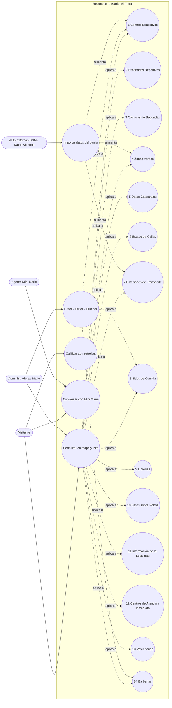

# Modelo de requerimientos — Reconoce tu Barrio: El Tintal

Estado al cierre de la Fase 1 (35 %), 2026-11-14.

**Fuentes**, en orden de autoridad: `docs/origen/ESPECIFICACION_ORIGINAL_v4.md` (requisitos del curso) y `docs/origen/PROMPT_MAESTRO.md` (diseño). Las interpretaciones propias llevan su número de decisión (D#) de `PLAN_MAESTRO.md`.

> **Campos aprobados por Marie el 2026-11-14 (D63).** Antes eran *propuestos*: La especificación nombra los 14 casos de uso «definidos e implementados en clase», pero no trae sus campos. Los campos de este documento son **propuestos**: salen del PROMPT_MAESTRO §11.3 y del esquema migrado. Si los casos de clase definen otros campos, Marie debe indicarlo y se ajustan el esquema y este documento.

## 1. Actores

| Actor | Descripción | Puede |
|---|---|---|
| **Visitante** | Cualquier persona que entra a la plataforma, con o sin sesión | Consultar los 14 módulos, el mapa, la historia y la FAQ; cambiar idioma y accesibilidad; conversar con Mini Marie; calificar (con sesión, Fase 2) |
| **Administradora / Marie** | Cuenta con rol `admin` | Todo lo del visitante, más crear, editar y eliminar registros de los 14 módulos |
| **Agente Mini Marie** | Asistente del sistema (actor de sistema) | Percibir la navegación, reaccionar con gestos, responder y sugerir rutas |
| **APIs externas** | OpenStreetMap (Overpass, Nominatim), Datos Abiertos de Bogotá, Wikimedia Commons | Proveer los datos del barrio y las fotos libres que el ETL importa |

## 2. Diagrama de casos de uso

*Lectura:* «Consultar» y «Crear · Editar · Eliminar» se aplican a los 14 casos; el diagrama dibuja solo algunas flechas de administración y de ETL para que siga siendo legible.

## 3. Los 14 casos de uso

Todos comparten el mismo flujo CRUD (sección 4); cambian la geometría, los campos y las reglas propias.

| # | Caso de uso | Emoji | Geometría | Campos propuestos | Reglas propias | Estado Fase 1 |
|---|---|---|---|---|---|---|
| 1 | Centros Educativos | 🎓 | POINT | nombre, tipo (jardín/colegio/universidad), carácter (público/privado), dirección, jornadas, niveles, teléfono | El carácter no se inventa: sin evidencia, el registro se omite o queda «por verificar» (D42) | **Implementado de extremo a extremo**: 5 registros reales de OSM, mapa, lista, búsqueda, filtros, paginación, detalle |
| 2 | Escenarios Deportivos | ⚽ | POLYGON | nombre, deportes, superficie, iluminación, horario, acceso | — | Tabla migrada y ruta esqueleto |
| 3 | Sistemas de Cámaras de Seguridad | 📹 | POINT | código, tipo (policial/comunitaria/privada), operador, estado, fecha de instalación | Solo ubicación y metadatos; nunca video | Tabla migrada y ruta esqueleto |
| 4 | Zonas Verdes | 🌳 | POLYGON | nombre, área m², tipo (parque/alameda/jardín), arborización, estado | Área calculada en PostGIS | Tabla migrada y ruta esqueleto |
| 5 | Datos Catastrales | 🏠 | POLYGON | matrícula inmobiliaria, dirección, área de lote m², área construida m², pisos, uso, avalúo COP, estrato | Sin datos personales de propietarios | Tabla migrada y ruta esqueleto |
| 6 | Estado de Calles | 🛣️ | LINESTRING | nombre de vía, tipo de vía, material, estado (bueno/regular/malo), última intervención, reportes ciudadanos | — | Tabla migrada y ruta esqueleto |
| 7 | Estaciones del Sistema de Transporte | 🚉 | POINT | nombre, tipo (troncal TransMilenio/alimentador/SITP), líneas, dirección | — | Tabla migrada y ruta esqueleto |
| 8 | Sitios de Comida | 👨‍🍳 | POINT | nombre, especialidad, dirección, horario, rango de precios, calificación promedio | El promedio sale de las calificaciones | Tabla migrada y ruta esqueleto |
| 9 | Librerías | 📚 | POINT | nombre, dirección, horario, especialidad, calificación promedio | — | Tabla migrada y ruta esqueleto |
| 10 | Datos sobre Robos | 🚨 | POINT | fecha, franja horaria, modalidad, fuente | Datos agregados y anónimos, con aviso ético visible; Mini Marie pasa a tono preventivo | Tabla migrada, ruta esqueleto y reacción de alerta del avatar |
| 11 | Información o Datos de la Localidad | 🏛️ | Ficha (MULTIPOLYGON opcional) | nombre de la localidad, bandera, historia, población, superficie km², alcaldía local, retos | Es la tabla transversal `localidad_kennedy` (D40) | Tabla migrada y ruta esqueleto |
| 12 | Centros de Atención Inmediata | 🚑 | POINT | nombre, tipo (CAI/hospital/urgencias), dirección, teléfono 24/7 | — | Tabla migrada y ruta esqueleto |
| 13 | Veterinarias | 🐾 | POINT | nombre, servicios, dirección, horario, calificación promedio | — | Tabla migrada y ruta esqueleto |
| 14 | Barberías | ✂️ | POINT | nombre, dirección, horario, servicios, calificación promedio | — | Tabla migrada y ruta esqueleto |

Todos los registros llevan además `source_type`, `source_ref` y `verified`.

## 4. Flujos (comunes a los 14 casos)

### 4.1 Consultar un módulo
**Actor:** Visitante. **Precondición:** la API responde.

*Flujo principal*
1. El visitante abre el módulo desde el Sidebar, el Footer, una tarjeta o una acción rápida de Mini Marie.
2. El sistema muestra el mapa temático (solo El Tintal) con un marcador por registro y la lista paginada con su emoji.
3. El visitante busca por texto, filtra por atributo u ordena.
4. Cada tarjeta muestra los datos del registro y su procedencia («Verificado», «Por verificar» o «Dato de ejemplo»); «Ver en el mapa» lo centra en el mapa. La ficha de detalle con galería y calificación llega en la Fase 2.

*Flujos alternos*
- **A1 · Sin resultados:** la lista dice que no hay lugares que coincidan con la búsqueda.
- **A2 · API caída o error 5xx:** mensaje de error con botón «Reintentar»; el gesto empático de Mini Marie llega en la Fase 2.
- **A3 · Módulo aún no habilitado en la API (404):** se indica que el módulo todavía no tiene lugares registrados; no se trata como fallo.
- **A4 · Módulo inexistente:** página 404 general.

### 4.2 Crear, editar o eliminar un registro
**Actor:** Administradora. **Precondición:** sesión con rol `admin` (Fase 2, H21).

*Flujo principal*
1. La administradora abre el formulario del módulo.
2. Llena los campos y marca la geometría en el mapa.
3. El sistema valida con el esquema del módulo y comprueba que la geometría cae dentro de El Tintal.
4. El sistema guarda en SRID 4326 y confirma; Mini Marie celebra.

*Flujos alternos*
- **B1 · Sin sesión o sin rol admin:** 401/403; hoy toda escritura responde 401 (D41).
- **B2 · Datos inválidos:** 422 con el detalle por campo.
- **B3 · Eliminar:** pide confirmación antes de borrar; 204 al terminar.

### 4.3 Calificar (Fase 2)
1. El visitante con sesión elige de 0,5 a 5 estrellas en pasos de 0,5 y deja un comentario opcional.
2. El sistema guarda y recalcula el promedio y el ranking.
- **C1 · Sin sesión:** se le invita a iniciar sesión.

### 4.4 Conversar con Mini Marie
1. El visitante abre el chat; Mini Marie saluda nombrando la sección actual.
2. El visitante escribe o elige una pregunta sugerida.
3. Mini Marie responde y, si aplica, ofrece una acción rápida que lleva al módulo, al mapa o a la historia.
- **D1 · Pregunta no reconocida:** explica lo que sí puede hacer, sin inventar datos.
- **D2 · Módulo de robos:** tono preventivo y número de emergencia 123.
- *Fase 1:* repertorio local. *Fase 2:* `/api/v1/chat` con `ModelProvider`.

### 4.5 Importar datos del barrio (ETL)
1. Se ejecuta `python -m etl.import_osm` y luego `python -m etl.import_modules`.
2. El ETL consulta Overpass, recorta al polígono y escribe semillas GeoJSON con su procedencia.
3. `python -m etl.load_seed` valida y carga solo lo que cae dentro del polígono.
- **E1 · Dato sin evidencia suficiente:** se omite y se reporta en `skipped`, o queda «por verificar».

## 5. Requerimientos funcionales

| ID | Requerimiento | Fuente | Estado |
|---|---|---|---|
| RF-01 | Los 14 casos de uso con CRUD y mapa temático propio | Espec. §5.4 | 1 de 14 completo; 14 rutas esqueleto |
| RF-02 | Iconografía por emoji en mapas, maqueta 3D y tarjetas | Espec. §5.4 | Hecho (`categoryConfig.ts`) |
| RF-03 | Animación principal y mapa 3D del barrio en el inicio | Espec. §5.2, §5.4 | Hecho (H10) |
| RF-04 | Carrusel con fotografías del entorno | Espec. §5.2 | Hecho: 8 fotos libres de Commons con autor y licencia (H11) |
| RF-05 | Footer con FAQ y Perfil de la Creadora | Espec. §5.2 | Hecho. **D2:** «fija» se interpreta como «presente al final de todas las páginas», no pegada a la ventana |
| RF-06 | Sidebar con secciones comunes, ayuda e inicio de sesión | Espec. §5.3 | Hecho (colapsable, cajón en móvil) |
| RF-07 | Selector de idioma | Espec. §5.3 | Hecho: ES por defecto, EN, persistido |
| RF-08 | Barra de accesibilidad a la derecha: contraste y tamaño de letra | Espec. §5.3 | Hecho, más reducir movimiento |
| RF-09 | WhatsApp flotante en la esquina inferior derecha | Espec. §5.3 | Hecho (D7: glifo monocromo en la paleta) |
| RF-10 | Historia local con la bandera de la localidad | Espec. §5.4 | Ruta esqueleto; contenido en Fase 2 |
| RF-11 | Galerías contextuales con fotos reales | Espec. §5.4 | Fase 2 |
| RF-12 | Ranking por estrellas | Espec. §5.4 | Fase 2 |
| RF-13 | Bienvenida: avatares desde esquinas, laterales y centro con un gran «Hola» | Espec. §5.5 | Hecho (H12). **8 puntos:** «todas las esquinas, laterales y centro» se interpreta como 8 posiciones: 4 esquinas, centro izquierdo y derecho, centro superior e inferior. **D11:** se muestra una vez por sesión del navegador (`sessionStorage`) y el header permite repetirla |
| RF-14 | Chatbot con avatar pixel que reacciona a acciones y navegación | Espec. §5.5 | Reacciones y chat local hechos (H13); agente con backend en Fase 2 |
| RF-15 | Animación de carga con el avatar corriendo sobre la barra | Espec. §5.5 | Fase 2 |
| RF-16 | Inicio de sesión con roles admin y visitante | Prompt §11.5 | Fase 2 (H21) |

## 6. Requerimientos no funcionales

| ID | Requerimiento | Cómo se verifica | Estado |
|---|---|---|---|
| RNF-01 | Ningún archivo de código supera 100 líneas | `check_line_length` en ambos repos y hook de Claude Code | Cumple: 156 archivos FE y 99 BE |
| RNF-02 | SOLID en toda la estructura | `docs/CHECKLIST_SOLID.md` | Cumple en lo construido |
| RNF-03 | Dos repositorios independientes | `git log` de cada repo | Cumple |
| RNF-04 | Motor geoespacial PostGIS, SRID 4326, índices GIST | Prueba de migración | Cumple (ADR-001) |
| RNF-05 | Datos de OSM y Datos Abiertos de Bogotá, con procedencia | `source_type`, `source_ref`, `verified` en cada registro | Cumple |
| RNF-06 | Paleta oficial estricta | `tokens.test.ts`: solo hex de la paleta en los CSS y ningún hex suelto en los componentes | Cumple |
| RNF-07 | Accesibilidad WCAG 2.1 AA | axe-core en Vitest y en Edge real | 0 violaciones en 6 vistas × 2 anchos |
| RNF-08 | Pruebas automatizadas | Vitest (FE) y PyTest con cobertura ≥ 80 % (BE) | 142 pruebas FE; 103 pruebas BE, 98,56 % de cobertura |
| RNF-09 | Rendimiento 3D | Frame time y triángulos medidos (D12) | 7,06 ms y 40 352 triángulos en el equipo de desarrollo; falta gama media (H27) |
| RNF-10 | Interfaz bilingüe sin textos fijos | Claves i18n en ES y EN | Cumple |
| RNF-11 | Movimiento reducido respetado | Pruebas de la ruta reducida (bienvenida, chat, carrusel) | Cumple |

## 7. Decisiones pendientes de Marie

- **D38 · Límite de El Tintal.** Se usó UPZ 78 Tintal Norte ∪ UPZ 79 Calandaima (6,4966 km²) porque OSM no tiene un límite de «barrio El Tintal». Ver ARQUITECTURA, ADR-007.
- **Campos de los 14 casos.** Confirmar que los campos propuestos coinciden con los definidos en clase.
